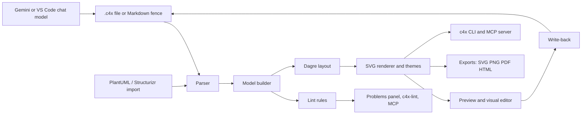

# C4X overview

C4X draws C4 architecture diagrams from plain text kept in your repository, and lets you edit them by dragging. It is a VS Code extension, with a command line and an MCP server for scripts and AI coding assistants. It is MIT licensed.

## 1. Why it exists

Architecture diagrams go stale because they live outside the repository. A diagram drawn in a canvas tool produces no diff, so a pull request that changes the containers cannot show the matching change to the diagram. Text-based tools fix the diff but need a Java runtime (Structurizr) or Graphviz or a server (PlantUML), and Mermaid renders inside Markdown while C4 does not. The architect draws the diagram once at design time, the code moves on, and reviewers stop trusting it. The [README](./README.md#the-problem) describes the three roles that feel this: the architect, the technical writer and the engineering manager.

## 2. What it does

C4X stores a diagram as text (`.c4x` files, or `c4x` fences in Markdown), draws it live in VS Code, and writes drag-and-drop edits back to the same text, so the diagram is reviewed like code. A lint pass checks the diagram against the C4 review checklist, and the same parser, linter and renderer run outside the editor, so an AI assistant or a CI job can write, check and draw a diagram too.

Key features:

- Text format for C4 context, container, component, deployment and dynamic views, with import from PlantUML C4 and Structurizr DSL.
- Live preview and a visual editor that saves layout and edits back to the source.
- Seven themes, including `c4-model`, which follows the notation published on c4model.com (shapes, type lines, boundaries, a diagram key).
- Export to SVG, PNG, PDF, HTML and the clipboard.
- 1,098 cloud icons (430 AWS, 624 Azure, 44 Google Cloud).
- C4 notation lint in the editor and as `c4x-lint` for Git hooks and CI, with SARIF output.
- Architecture conformance: a component view exports a dependency-cruiser allow-list, so an undeclared import fails CI.
- Diagram generation from code with Gemini, or with a chat model already in VS Code (`c4x.ai.provider`).
- An MCP server (`validate_c4x`, `lint_c4x`, `render_c4x`), an agent skill and plugins for Claude Code, Codex, Gemini CLI and Antigravity.

## 3. Release stage and where to see it

Stage: public. The extension is published on two registries.

| Registry | Link | Checked 2026-11-19 |
|---|---|---|
| VS Code Marketplace | <https://marketplace.visualstudio.com/items?itemName=jpantsjoha.c4x> | Lists version 1.9.2. |
| Open VSX | <https://open-vsx.org/extension/jpantsjoha/c4x> | HTTP 200; lists version 1.9.2. |

The published version is 1.9.2 (released 2026-11-19). Versions 1.8.1 to 1.9.0 were tagged and not published; 1.9.2 carries their changes. Install with `code --install-extension jpantsjoha.c4x`.

## 4. Recent releases

Dates are from [CHANGELOG.md](./CHANGELOG.md) and the Git tags.

| Version | Date | Status | Highlights |
|---|---|---|---|
| 1.9.2 | 2026-11-19 | Published | The first published release since 1.8.0: it carries 1.9.0, a warning for a subgraph, boundary block or direction statement inside a deployment node (#472), and large views laid out in a worker with a 2 s deadline (#454). |
| 1.9.0 | 2026-11-17 | Tagged, not published | C4 notation refresh (shapes, `c4-model` theme, boundaries, key); an agent skill, plugins and `render_c4x`; generation with a VS Code chat model; an npm package for scripts and agents; a smaller package (2.6 MB to 1.8 MB). |
| 1.8.3 | 2026-11-15 | Tagged, not published | Folder generation skips credential files and shows what it will send. |
| 1.8.2 | 2026-11-15 | Tagged, not published | Security hardening for diagram rendering and the MCP server. |
| 1.8.0 | 2026-10-15 | Published 2026-10-16 | C4 notation and coherence lint, `c4x-lint` outside VS Code, `$code` mapping and architecture conformance export, move to the `@google/genai` SDK. |

## 5. How it works

A diagram is text. A Peggy grammar parses it into a model, a layout engine places the elements, and a renderer draws SVG. The preview, the exports, the CLI and the MCP server all call the same renderer, so a diagram looks the same everywhere. Edits made by dragging go through a write-back layer that changes the source text, so the text stays the single source of truth and the diff stays reviewable. This answers the problem in section 1: the diagram lives in the repository, changes with the code and shows in the pull request.

| Component | Path | Responsibility |
|---|---|---|
| Extension entry | `src/extension.ts` | Activates the extension and registers commands, providers and the preview. |
| Parser | `src/parser/` | Peggy grammar (`c4x.pegjs`) for C4X, plus PlantUML and Structurizr importers. |
| Model | `src/model/` | Builds the C4 model and its legality checks; the lint rules sit in `src/model/lint/`. |
| Layout | `src/layout/` | Dagre-based placement of elements and boundaries. |
| Render | `src/render/` | Draws elements, boundaries, edges, labels and the key as SVG. |
| Themes | `src/themes/` | Seven themes, including `c4-model` and `c4-standard`. |
| Preview and editor | `src/webview/` | The preview panel and the visual editor. |
| Write-back | `src/writeback/` | Applies visual edits to the source text as one transaction. |
| Export | `src/export/`, `src/commands/` | SVG, PNG, PDF, HTML and clipboard export; theme and model commands. |
| Diagnostics | `src/diagnostics/` | Shows parse errors and lint findings in the Problems panel. |
| Conformance | `src/conformance/` | Turns a component view into a dependency-cruiser allow-list. |
| AI generation | `src/ai/` | Gemini and VS Code chat-model providers, prompts, validation and repair loop. |
| Completion and hover | `src/completion/` | Completions and hover for attributes, shapes and `$code`. |
| Markdown | `src/markdown/` | Renders `c4x` fences in the Markdown preview. |
| Command line | `src/cli/`, `cli/` | `c4x-lint` and `c4x render`, bundled as `cli/c4x-lint.cjs` and `cli/c4x.cjs`. |
| MCP server | `mcp/`, `src/mcp/` | The `validate_c4x`, `lint_c4x` and `render_c4x` tools; registration with VS Code chat. |
| Agent skill and plugins | `skills/c4x/`, `plugins/c4x/` | The skill and its packaging for Claude Code, Codex, Gemini CLI and Antigravity. |
| npm package | `npm/` | The `c4x` package carrying the MCP server, `c4x render` and `c4x-lint`. |
| Icons | `data/`, `src/assets/` | Cloud icon packs; see [NOTICE.md](./NOTICE.md). |
| Tests | `src/__tests__/`, `test/` | Unit tests, extension-host, browser and smoke tests. |
| Build and gates | `Makefile`, `scripts/`, `esbuild.config.js` | Build, package and the local check targets. |

## 6. Quality evidence

- Test command: `make test-unit` for the unit tier; `make check` is the pull-request gate (typecheck, lint, unit tests under coverage, MCP and CLI tests, notation lint, documentation checks, build). `make test` runs the extension-host tests in a real VS Code.
- Last measured, 2026-11-18 on macOS with Node 20.20.2: `make test-unit` 4,709 passing, 1 pending (a clean run of `make check` on the head of release pull request #550, merged as `d956200`, reported 4,714 passing).
- Coverage: `make test-unit-coverage` enforces floors of 80% lines, statements and functions and 85% branches with c8 over `src/`, excluding files listed in the `coverage` script in `package.json`, including `src/webview/`, `src/export/`, `src/commands/`, `src/diagnostics/`, `src/completion/`, `src/markdown/`, `src/extension.ts`, `src/ai/AuthService.ts`, `src/ai/CodeContextExtractor.ts` and `src/ai/GeminiService.ts`. The last recorded figure is 92.72% lines from `make coverage-all` on 2026-11-15, at 3,303 unit tests; no figure has been measured since.
- Gates: the pull-request gate and release gate are local make targets (`make check`, `make check-full`); no hosted CI runs on this repository. A pre-commit check also rejects workstation paths, credentials and internal references in files that ship.

## 7. More

[run_instruction.md](./run_instruction.md) (build, run, test) · [DEPENDENCIES.md](./DEPENDENCIES.md) · [CHANGELOG.md](./CHANGELOG.md) · [NOTICE.md](./NOTICE.md) · [docs index](./docs/README.md) · [SECURITY.md](./SECURITY.md) · [CONTRIBUTING.md](./CONTRIBUTING.md)
