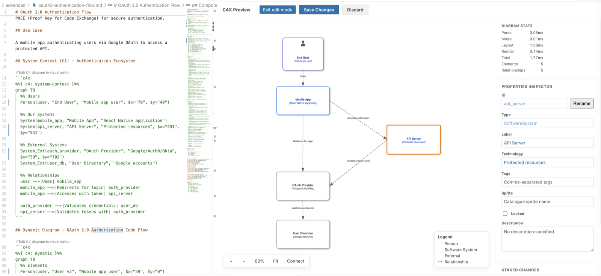
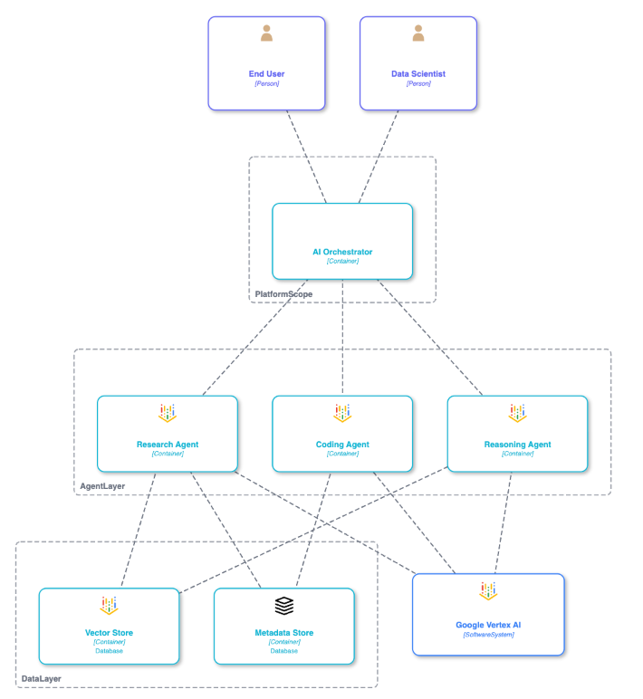

# C4X — C4 Architecture Diagrams for VS Code

C4 architecture diagrams as version-controlled text in your repository, edited visually by dragging.

Build, run and test: see [run_instruction.md](./run_instruction.md).

[](https://marketplace.visualstudio.com/items?itemName=jpantsjoha.c4x)
[](https://open-vsx.org/extension/jpantsjoha/c4x)
[](https://marketplace.visualstudio.com/items?itemName=jpantsjoha.c4x)
[](https://www.typescriptlang.org/)


```bash
code --install-extension jpantsjoha.c4x
```



## 1.8.0 highlights

C4X 1.8.0 adds C4 notation checks, component-to-code mapping and architecture conformance checks. Visual editing gains safer relationship saves, multi-selection dragging and clearer staged changes. Gemini uses the current Google SDK with live-tested model discovery and failover.

From a Markdown preview, click **Edit C4 diagram** beneath the diagram to open its visual editor; confirm **Open** if the IDE asks to open the extension link. In source view, click the CodeLens above a `c4x` fence, or right-click inside the fence and choose **Edit C4 diagram in visual editor**. In the visual panel, select **Edit C4 Diagram**, select an element, change its properties, review the diff, then choose **Save Changes**. **Discard** cancels staged edits. Save an untitled Markdown file before using preview links.

This release fixes preview links that silently did nothing and ensures each link opens its own file and diagram after preview refreshes. See [1.8.0 release notes](docs/releases/1.8.0.md) for changes and known limitations.

## Traction

Registry figures read on 2026-09-09; repository figures measured on 2026-09-10 at `21e57e6`, except the commit counts below, read on 2026-09-09.

- **1,588 installs** on the VS Code Marketplace and **7,053 downloads** on Open VSX.
- **Version 1.7.0 published 2026-09-07** on both registries. The first Marketplace release was 2025-12-04.
- **469 commits since 2025-10-19:** 467 from one human author and two from a test-fixture identity, across 82 merged pull requests, 101 merge commits and 10 release tags.
- **Six test tiers:** 1,569 unit tests at `21e57e6` (counted by `pnpm run test:unit`), 497 extension-host tests, 126 browser tests, a packaged-VSIX smoke test on Windows, macOS and Linux, a live Gemini generation gate, and an MCP functional check. The release gate holds the unit tier to a line and branch coverage floor.
- **Built in:** 1,098 cloud sprites (430 AWS, 624 Azure, 44 Google Cloud), six themes at WCAG AA contrast, Structurizr DSL and PlantUML C4 import, and a Model Context Protocol server in the repository.

## The problem

Architecture diagrams rot because they live outside the repository. Three roles feel it differently.

**Alex, a software architect.** The container diagram belongs in the pull request that changes the containers. Structurizr wants a Java runtime, PlantUML wants Graphviz or a server, and both sit outside the editor. So Alex draws the diagram once, at design time, and never again.

**Jordan, a technical writer.** Mermaid renders inside Markdown; C4 does not. Jordan exports a PNG, uploads it, links it, and watches it go stale the week the code changes.

**Sam, an engineering manager.** Every team picks a different drawing tool, and a proprietary canvas file produces no diff. Architecture never reaches code review, so Sam cannot enforce a standard the team never sees.

## The solution

**Alex** writes `architecture.c4x` beside the code and presses `Cmd+K V`. Dragging a box stages a coordinate change, the inspector shows the exact source diff, and **Save Changes** writes `$x` and `$y` back into the file. The diagram travels in the commit that changed the code.

**Jordan** puts a fenced `c4x` block inside the Markdown file. The VS Code preview renders it live. There is no image to export, host or refresh.

**Sam** reads architecture the way the team reads code. A moved container is two changed numbers in a text diff, on a branch, in a pull request.

## What it does

**1. Write text, see the diagram.** Create `architecture.c4x`, write a few lines of Mermaid-like syntax, press `Cmd+K V` (or `Ctrl+K V`). C4X parses the source and renders locally. No network call, no rendering service.

**2. Generate a model from code.** Run `C4X: Generate Diagram Here (Gemini)`. Gemini reads the surrounding files and drafts a C4 model at the cursor. C4X parses the output before it reaches the document and re-prompts up to twice if the syntax is wrong.

**3. Arrange by dragging.** Automatic layout gives you structure; you supply the emphasis. Drag gestures stage coordinates for review. Native `.c4x` files take `$x` and `$y` inline; imported formats use a layout sidecar so the original file is never rewritten.

**4. Edit the model on the canvas.** Change an element's label, technology, description, tags or sprite. Renaming an element rewrites every relationship that references it. Draw new relationships, or move an existing one to a different endpoint.

**5. Review before saving.** Every visual change is staged before it touches disk. Read the unified diff against your source, drop individual changes, then save the batch as one undo step.

**6. Export and embed.** SVG for Figma or Illustrator, PNG at 1x, 2x or 4x without a headless browser, or SVG straight to the clipboard. Fenced `c4x` blocks render live in the VS Code Markdown preview.

**7. Check the notation.** C4X checks each diagram against the C4 review checklist and lists what is missing in the Problems panel: a container with no technology, an unlabelled arrow, a component drawn in a system context view. Every finding carries a stable rule id and a fix, never blocks the preview, and has a severity you can change per rule. Rules and settings: [C4X lint rules](./docs/C4X-LINT-RULES.md).

## Design choices

- **No second runtime.** The package is about 1.47 MB and needs no Java, no Graphviz, no Docker and no rendering server. Preview and export run locally.
- **Write-back that fails closed.** A visual change that cannot be turned into valid source is abandoned rather than written. Each completed action is one `WorkspaceEdit` and one undo step, reparsed and validated before it is acknowledged.
- **Generation a parser has checked.** Gemini drafts the model; the C4X parser decides whether it is admissible. Failures are corrected by re-prompting with the parser's own error, at most twice, before anything is inserted.
- **Your key, your bill.** Gemini calls use your own API key, held in VS Code SecretStorage. C4X has no backend, no hosted service and no telemetry, so nothing about your code leaves the machine except the context you asked to send.
- **Diagrams in the diff.** Models are plain text in the repository. They branch with the feature, review in the pull request, and survive the people who wrote them.

## New in 1.7.0

- **Gemini model pickers.** `C4X: Select Gemini Model` and `C4X: Select Gemini Image Model` list the models your key can reach, marking preview, retired and specialist ones. Lists are cached for a day.
- **Steadier arranging.** Nested boundaries resize child-first and keep authored origins and minimum sizes. Relationship-label layout no longer shifts elements you placed by hand. Discarding a move rewraps the frame around it.
- **The preview stays put.** The visual editor opens reliably, and focusing the preview keeps its binding to the source document instead of clearing the diagram.
- **Clearer recovery.** A failed save retries its rollback up to three times, and restoring a draft says which targets are missing.
- **Clean installs, checked on three systems.** Clean-install checks run on Windows, macOS and Linux. Development files are out of the VSIX, and browser failures or high- and critical-severity dependency findings block a release.

Full detail: [1.7.0 changelog](./CHANGELOG.md#170---2026-09-07).

## Roadmap

- **1.8.0 — model quality checks, a supported AI SDK and sturdier editing.** Check a model as you write it with C4 notation and coherence lint, run the same lint from a git hook, CI or MCP, and export a component view as a dependency-cruiser architecture check. Move Gemini calls to the `@google/genai` SDK. Fix diagram-editing defects found in installed testing. Ship third-party licence notices in the package.
- **1.8.1 — draft recovery and model authoring.** Harden draft identity and schema migration. Add elements from a C4-aware palette. Delete elements and relationships with dependent-relationship review.
- **1.9.0 — more checkers, agent-ready.** ArchUnit-family PlantUML export, MCP self-registration in VS Code, and a published agent skill.
- **1.10.0 — larger models.** Drill from a C1 context into the C2 container file behind it, and load organisation-specific icon packs.
- **Beyond the sequenced roadmap.** Unsequenced aspirations, not commitments: detect drift between code and model in CI, share branch-aware editing sessions through Git, and generate a static architecture portal from the repository.

Detail and delivery rules: [product roadmap](./docs/ROADMAP.md).

## Quick start

Install from the Extensions view (`Cmd+Shift+X` or `Ctrl+Shift+X`) by searching for `C4X`, or from the command line:

```bash
code --install-extension jpantsjoha.c4x
```

The same extension is on Open VSX as `jpantsjoha.c4x`.

Create `architecture.c4x`, paste this, and press `Cmd+K V` (macOS) or `Ctrl+K V` (Windows and Linux):

```c4x
%%{ c4: system-context }%%
graph TB

Customer[Customer<br/>Person]
Banking[Banking System<br/>Software System]
Email[Email System<br/>Software System<br/>External]

Customer -->|Uses| Banking
Banking -->|Sends notifications| Email
```

The same block inside a fenced `c4x` code block renders live in the Markdown preview.

The first line declares the view: `system-context`, `container`, `component`, `deployment` or `dynamic`. The second sets direction: `graph TB`, `LR`, `BT` or `RL`. Elements take bracket or function form, arrows carry the relationship, and a `subgraph` draws a boundary:

```c4x
%%{ c4: container }%%
graph TB
    User[User<br/>Person]

    subgraph BankingSystem {
        WebApp[Web App<br/>Container]
        Database[DB<br/>Container]
    }

    User -->|Uses| WebApp
    WebApp ==>|Reads and writes| Database
```

`-->` is a dependency, `==>` a synchronous call and `-.->` an asynchronous one. Function syntax adds technology and sprite icons:

```c4x
Container(WebApp, "Web App", "React", $sprite="c4xicons.aws.elastic-beanstalk-application")
ContainerDb(DB, "Database", "PostgreSQL")
Person(User, "End User")
```

In bracket form C4X understands the type labels `Person`, `Software System`, `Container`, `ContainerDb`, `Component` and `ComponentDb`. In function form the equivalents are `Person`, `System`, `SystemDb`, `Container`, `ContainerDb`, `Component` and `ComponentDb`, each with an `*_Ext` external variant. Full grammar: [syntax guide](./docs/c4x-syntax.md). Worked models: [examples](./docs/EXAMPLES.md).

To generate diagrams from code, get a key from [Google AI Studio](https://aistudio.google.com/), run `C4X: Set Gemini API Key`, and paste it. C4X stores it in VS Code SecretStorage; it is never written to a settings file. `C4X: Clear Gemini API Key` removes it.

The default model is `gemini-3.8-flash`, with a single failover to `gemini-3.1-pro-preview` when the first model fails. `C4X: Select Gemini Model` lists what your key can reach. Guides: [Gemini generation](./docs/GEMINI_GUIDE.md) and [visual diagrams](./docs/DIAGRAM-WITH-GEMINI-IMAGE.md).

Editing and export commands live under the same prefix: `C4X: Open Preview`, `C4X: Export SVG`, `C4X: Export Diagram as PNG`, `C4X: Copy SVG To Clipboard` and `C4X: Diagram from Selection`.

## MCP server

The repository ships a standalone Model Context Protocol server so coding agents can check C4X syntax themselves. It is a single bundle and needs no `node_modules`, so it runs in a clean clone:

```json
{
  "mcpServers": {
    "c4x-validator": {
      "command": "node",
      "args": ["/absolute/path/to/c4x-vscode-extension/mcp/c4x-mcp-server.bundle.cjs"]
    }
  }
}
```

The `validate_c4x` tool returns line and column errors an agent can act on, and the server exposes `c4x://guidelines`, `c4x://syntax` and `c4x://examples/*`. It works with Claude Desktop, Cursor, Windsurf, Cline and other MCP clients; Codex takes the same command in `.codex/config.toml`.

## Known limitations

- A reload loses pan and zoom when nothing else has changed, because C4X persists element coordinates but not the camera. Restoring a draft whose target elements have gone raises a warning. Save important changes before closing or switching diagrams.
- A relationship label can land in a different place after a save than it held during the drag, and a long description overflows its node box. Resize-handle placement and mixed boundary and node edits remain under review.
- Only a boundary written as `subgraph` can be positioned or resized by hand, because only `subgraph` takes `$x`, `$y`, `$w` and `$h`. A boundary written as `System_Boundary`, `Container_Boundary` or `Enterprise_Boundary` has nowhere in the syntax to keep a position. In 1.7.0 the editor still offers to drag one and then refuses the whole save; an unreleased change leaves it fixed instead. Rewriting a boundary as a `subgraph` makes it movable and drops its C4 type, so the C4 lint rules for boundaries no longer apply to it.
- C4X cannot yet add an element from a palette, or delete an element or a relationship. Both are planned.

## For developers

C4X builds on Node 20.20.2 (`.nvmrc`):

```bash
pnpm install       # install dependencies
make quick-check   # typecheck, lint, unit tests, harness and MCP checks
make check         # the above, plus documentation verification and a build
```

Press `F5` in VS Code to launch the Extension Development Host with the extension loaded.

Read [CONTRIBUTING.md](./CONTRIBUTING.md) for the branch, test and review rules, and the [documentation index](./docs/README.md) for guides and examples. Issues and pull requests go to [GitHub](https://github.com/jpantsjoha/c4x-vscode-extension/issues).

## Icons



The bundled AWS, Azure and Google Cloud sprites belong to their vendors, not to this project. [NOTICE.md](./NOTICE.md) records the attribution and sources; [docs/ICONS.md](./docs/ICONS.md) lists the catalogue.

## Licence

MIT. See [LICENSE](./LICENSE).

- [C4 model](https://c4model.com/) by Simon Brown.
- [Mermaid.js](https://mermaid.js.org/) for syntax inspiration.
- [Dagre](https://github.com/dagrejs/dagre) for graph layout.

---

Built by [Jaroslav Pantsjoha](https://jpantsjoha.com) · [GitHub repository](https://github.com/jpantsjoha/c4x-vscode-extension) · [Issues](https://github.com/jpantsjoha/c4x-vscode-extension/issues)
