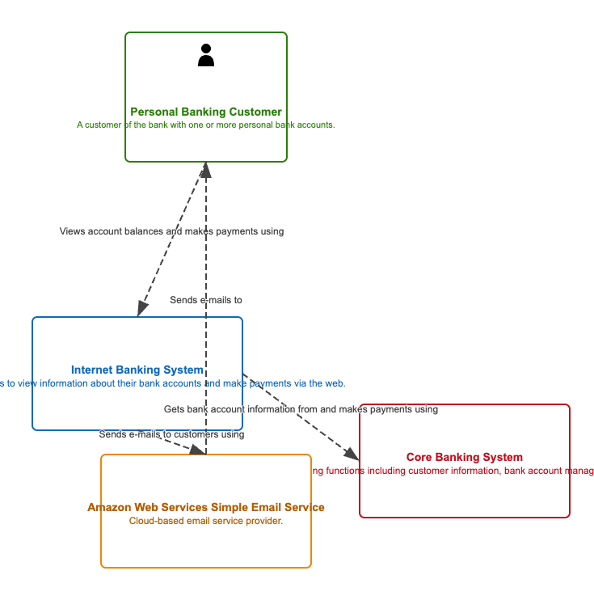
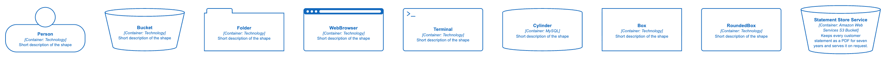
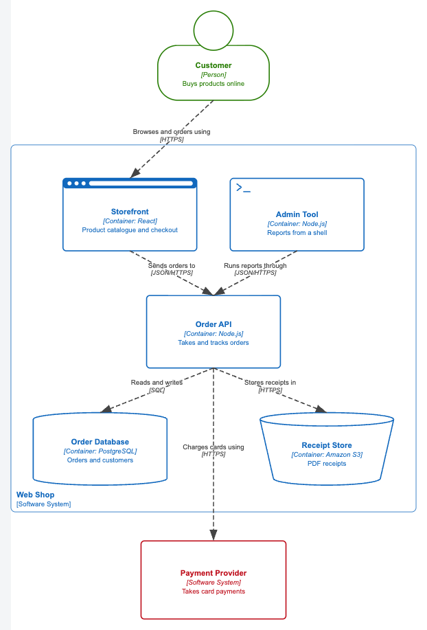

# C4X Valid Element Types

This document lists all valid C4 element types accepted by the C4X parser.

Element calls take attributes after the quoted texts, `Type(id, "Label", ..., $key="value")`. The quoted texts depend on the type.

For a Container, Component or Node the third argument is the technology, drawn in square brackets under the label, and the fourth is the description. For a Person or a software system, the form is `Person(id, "Label", "Description")`: the one text after the label is the description, drawn as plain text. Give a Person or system two texts and they mean technology, then description. The full, generated signature, every spelling and the placement rules are in [the C4X reference](reference/c4x-reference.md); this page explains the types in words and does not repeat them.

## Valid Element Types

The C4X extension strictly enforces the C4 Model element type taxonomy. The following element types are supported:

### Person

Represents a human user or actor in the system.

Spellings: `Person` and `Person_Ext` (a person outside the scope).

**Aliases**: `person`, `person_ext`

**Example**:

```c4x
%%{ c4: system-context }%%
graph TB
  Person(user, "Customer", "End user of the system")
  Person_Ext(support, "Support Team", "External support staff")
```

### Software System

Represents a software system - the highest level of abstraction.

Spellings: `System`, `System_Ext` (outside the scope), `SystemDb` (drawn with a database shape) and `SystemDb_Ext`.

**Aliases**: `system`, `system_ext`, `systemdb`, `systemdb_ext`, `software system`, `softwaresystem`

**Example**:

```c4x
%%{ c4: system-context }%%
graph TB
  System(app, "Mobile App", "Primary user interface")
  System_Ext(payment, "Payment Gateway", "External payment processor")
```

A person's or software system's third argument is its description. C4X draws it as plain text
under the name, with no brackets: there is no technology line for a person or system. A
container, component or deployment node takes a technology first and draws it as
`[Technology]` in italics. A person or system written with two text arguments,
`System(id, "Label", "Technology", "Description")`, keeps its technology line.



### Container

Represents an application or data store within a system.

Spellings: `Container`, `Container_Ext` (outside the scope), `ContainerDb` (drawn with a database shape) and `ContainerDb_Ext`.

**Aliases**: `container`, `container_ext`, `containerdb`, `containerdb_ext`

**Example**:

```c4x
%%{ c4: container }%%
graph TB
  Container(api, "REST API", "Node.js", "Handles business logic")
  ContainerDb(db, "Database", "PostgreSQL", "Stores user data")
```

### Component

Represents a code-level component within a container.

Spellings: `Component`, `Component_Ext` (outside the scope), `ComponentDb` (drawn with a database shape) and `ComponentDb_Ext`.

**Aliases**: `component`, `component_ext`, `componentdb`, `componentdb_ext`

**Example**:

```c4x
%%{ c4: component }%%
graph TB
  Component(ctrl, "UserController", "TypeScript", "Handles user requests")
  Component(svc, "UserService", "TypeScript", "Business logic layer")
```

### Deployment Node

Represents infrastructure nodes in deployment diagrams.

Spelling: `Node`, with the same signature. A node can hold child elements in braces: `Node(id, "Label", "Technology", "Description") { ... }`.

**Aliases**: `node`

## Shapes

An element is a rectangle until you give it a shape. `$shape="Name"` is a key-value argument after the quoted texts, and it works on a Container, a Component and a Node, and on a Person or a software system. The name is case sensitive.

| `$shape` | Draws | Use it for |
|---|---|---|
| `Person` | A head over a rounded body | A person or a role |
| `Cylinder` | A database drum | A database |
| `Bucket` | A bucket | An object store |
| `Folder` | A folder with a tab | Files or a file system |
| `WebBrowser` | A window with a title bar | A web page or single-page app |
| `Terminal` | A window with a prompt | A command-line tool |
| `RoundedBox` | A rectangle with rounded corners | A plain element that needs a softer look |
| `Box` | A rectangle | Setting the plain rectangle again over a tag style |

```c4x
%%{ c4: container }%%
graph TB
  Container(web, "Storefront", "React", "Catalogue and checkout", $shape="WebBrowser")
  Container(db, "Order Database", "PostgreSQL", "Orders and customers", $shape="Cylinder")
  Container(files, "Receipt Store", "Amazon S3", "PDF receipts", $shape="Bucket")
  Container(share, "Statement Share", "NFS", "Monthly statements", $shape="Folder")
  Container(cli, "Admin Tool", "Node.js", "Reports from a shell", $shape="Terminal")
  Person(clerk, "Clerk", "Runs the reports", $shape="Person")
```



Eleven more names are valid (`Circle`, `Ellipse`, `Hexagon`, `Diamond`, `Pipe`, `Robot`, `Window`, `Shell`, `MobileDevicePortrait`, `MobileDeviceLandscape` and `Component`). The renderer does not draw them yet and shows the theme rectangle, with an information finding (`C4X-L111`). A name outside the 19 draws the theme rectangle and a warning (`C4X-L110`). A tag can set a shape for every element that carries it: `elementStyle Queue $shape="Cylinder"`. The full rules, the text areas inside each shape and the `elementStyle` keys are in [element styles](c4x-syntax.md#element-styles-elementstyle-shape).

In the editor, type `$sh` and accept `$shape` to pick a name from the list. The snippets `container-database`, `container-bucket`, `container-folder`, `container-browser`, `container-terminal`, `container-rounded`, `container-box`, `person-shape` and `shape` insert a whole element.

## Notation in the c4-model theme

The `c4-model` theme (select it with `c4x.theme` or **C4X: Change Theme**) draws the notation of the c4model.com examples. Each element prints its C4 type under its name, as `[Person]`, `[Software System]` or `[Container: technology]`. People draw in green, the software system in scope in blue, external systems in red. A boundary is a thin solid frame labelled `[Software System]` or `[Container]` at the bottom left, and a deployment node carries its icon and `[Deployment Node: technology]` there too. The other themes keep their own look. The picture below combines a shape for each kind of store, a boundary and the technology of every relationship, in `[square brackets]` under its label:



## Invalid Element Types

The following are **NOT** valid C4 element types and will cause parse errors:

- ❌ `Developer` - Use `Person` instead
- ❌ `User` - Use `Person` instead (or as an ID, not a type)
- ❌ `Database` - Use `ContainerDb` or `SystemDb` instead
- ❌ `Service` - Use `Container` instead
- ❌ `API` - Use `Container` or `System` instead
- ❌ `Module` - Use `Component` instead
- ❌ `Class` - Use `Component` instead
- ❌ Any other custom types

## Validation

### Real-time IDE Validation

The C4X extension provides real-time syntax validation in VS Code:

1. **DiagnosticsManager**: Validates C4X code blocks in markdown files as you type
2. **Error Highlighting**: Invalid element types are highlighted with red squiggles
3. **Error Messages**: Hover over errors to see "Unsupported element type" messages

### Pre-commit Validation

The validation script runs automatically during pre-commit:

```bash
pnpm run validate:docs
```

This script:

1. Scans all markdown files for `c4x` code blocks
2. Parses each block using the PEG.js grammar
3. **Validates element types** by building the C4 model
4. Reports any syntax or element type errors

### Manual Validation

To manually validate all examples:

```bash
make verify-docs
```

## Common Mistakes

### 1. Using descriptive names as types

**Wrong**: Using `Developer` as an element type

```text
Developer(john, "John Doe", "Software engineer")
```

**Correct**: Use `Person` instead

```c4x
%%{ c4: system-context }%%
graph TB
  Person(john, "John Doe", "Software engineer")
```

### 2. Confusing element ID with element type

The syntax is: `Type(id, "label", ...)`

**Wrong**: Using the type name as the ID and referencing the type in relationships

```text
Person(Person, "User", "Uses the system")
Person -->|uses| System  // This references the type, not an ID!
```

**Correct**: Use a unique ID and reference it in relationships

```c4x
%%{ c4: system-context }%%
graph TB
  Person(user, "User", "Uses the system")
  System(app, "Application", "The main system")

  user -->|uses| app
```

### 3. Case sensitivity

Element types are case-insensitive but normalized:

```c4x
%%{ c4: system-context }%%
graph TB
  Person(id1, "User 1")
  person(id2, "User 2")
  PERSON(id3, "User 3")
```

All three are treated as `Person` type.

## Reference

Element type mapping is defined in `src/model/C4ModelBuilder.ts`:

```typescript
const ELEMENT_TYPE_MAP: Record<string, C4ElementType> = {
    'person': 'Person',
    'person_ext': 'Person',
    'software system': 'SoftwareSystem',
    'softwaresystem': 'SoftwareSystem',
    'system': 'SoftwareSystem',
    'system_ext': 'SoftwareSystem',
    // ... etc
};
```

For the complete list, see: `src/model/C4ModelBuilder.ts` (lines 5-23)
