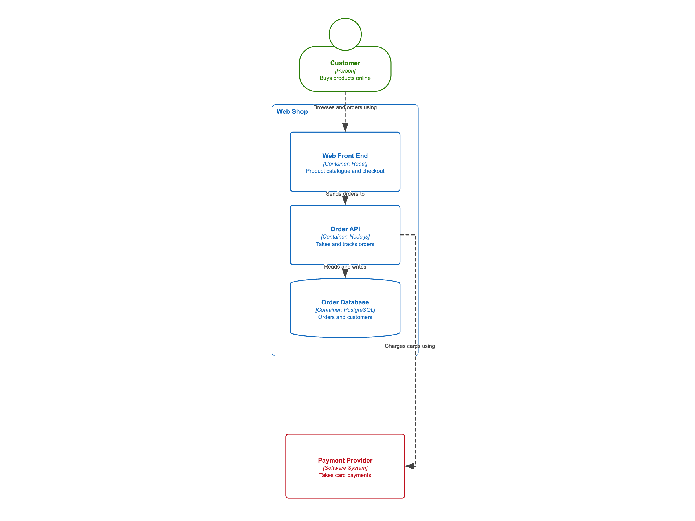

# Render C4X outside VS Code: `render_c4x` and `c4x render`

From 1.9.0 an AI coding agent, a script or a CI job can draw a C4X diagram as SVG without VS Code. Two entry points do the same job:

- **`render_c4x`**, a tool on the C4X MCP server (`mcp/c4x-mcp-server.bundle.cjs`), for agents;
- **`c4x render`**, a command in the single-file bundle `cli/c4x.cjs`, for shells, hooks and CI.

Both call the parser, model builder, lint rules, layout and SVG renderer the extension's preview uses, so the picture is the preview's picture. A test renders every snapshot fixture, in every theme, through the extension's code path, the MCP bundle and the CLI bundle, and fails if the three disagree.

## Example

Save this as `web-shop.c4x`:

```c4x
%%{ c4: container }%%
graph TB
Person(customer, "Customer", "Buys products online")
System_Boundary(shop, "Web Shop") {
    Container(web, "Web Front End", "React", "Product catalogue and checkout")
    Container(api, "Order API", "Node.js", "Takes and tracks orders")
    ContainerDb(db, "Order Database", "PostgreSQL", "Orders and customers")
}
System_Ext(pay, "Payment Provider", "Takes card payments")
customer -->|Browses and orders using| web
web -->|Sends orders to|"JSON/HTTPS" api
api -->|Reads and writes|"SQL" db
api -->|Charges cards using|"HTTPS" pay
```

Then draw it in the `c4-model` theme:

```sh
node cli/c4x.cjs render --theme c4-model web-shop.c4x -o web-shop.svg
# c4x render: drawn in the c4-model theme: 8051 bytes, 0 findings
```



An agent gets the same SVG from `render_c4x` with `{ "code": "<the source above>", "theme": "c4-model" }`.

## `c4x render`

```text
c4x render [--theme <name>] [--format svg|png] [--view <n>] [-o <file>] [file.c4x | -]
```

| Option | Meaning |
|---|---|
| `file.c4x` | The diagram to draw. `-`, or no file, reads standard input. |
| `--theme` | `classic` (the default, as in the extension), `c4-model`, `c4-standard`, `modern`, `muted` or `high-contrast`. `auto` follows the editor's colours, so it is not offered. |
| `--format` | `svg` (the default). `png` is reserved: this version writes the SVG and says PNG is not available. |
| `--view` | 0-based view to draw. A C4X source has one view, `0`. |
| `-o`, `--output` | Write the SVG to this file instead of standard output. |

The SVG goes to standard output, or to the one file named with `-o`. Nothing else is written, and no path is ever taken from the diagram's text. An `-o` that names the input file, or a link to it, is refused. Findings (syntax, model, element-style and lint) go to standard error as `line:column severity ruleId message hint`, followed by a summary line.

| Exit code | Meaning |
|---|---|
| 0 | The SVG was written. Lint findings alone never stop the render. |
| 1 | Not drawn: the source does not parse, exceeds an input limit, has a model error, or the render is too large. The findings say why. |
| 2 | Usage, input or internal error: a bad option, an unreadable or over-large file, an empty source. |
| 3 | Not drawn: the render was still running at the 2-second deadline and was stopped. The findings are printed; no SVG is written. |

`cli/c4x.cjs` needs only Node.js 18 or later; it embeds its dependencies (licences in `cli/THIRD_PARTY_NOTICES.txt`) and reads the AWS and Azure icon data from `data/cloud-icons.json` beside its `cli/` directory, which the repository and the npm package both carry. It checks the file against a SHA-256 built into the bundle; a missing or altered file stops the render with a `C4X-RENDER` message, and no placeholder icon is drawn. `c4x-lint` remains the lint command.

## `render_c4x`

| Input | Meaning |
|---|---|
| `code` (required) | The C4X source: the body of a `.c4x` file or of a `c4x` fence. |
| `theme` | As `--theme` above. |
| `view` | As `--view` above. |
| `format` | As `--format` above. |

The result has two content items when the diagram was drawn:

1. **Text:** `Render OK. <n> bytes of SVG in the <theme> theme, in the next content item (c4x://render/diagram.svg). <count> findings: …`, then a `Note:` line for a `png` request, then one line per finding (at most 200).
2. **Resource:** the SVG, MIME type `image/svg+xml`, URI `c4x://render/diagram.svg`. It is never mixed into the text item.

Code that does not parse, exceeds a limit or has a model error returns `Render NOT DONE.` with its findings, no SVG and `isError: true`. A render over the bounds returns `Render TOO LARGE.` the same way, and one stopped at the deadline returns `Render TOO SLOW.` A bad `theme`, `view` or `format` is an `Input ERROR.`

## Limits

| Bound | Value |
|---|---|
| Source size | 1 MiB (UTF-8) |
| Nesting, elements, relationships, text, list entries | As `validate_c4x` (see [the reference](reference/c4x-reference.md#input-limits)) |
| Elements and boundaries drawn | 100 |
| Relationships drawn | 150 |
| SVG returned | 2 MiB |
| Time per render | 2 seconds, enforced (see below) |

Layout time grows faster than linearly with the number of elements and relationships: 2,000 elements took 2.8 to 6.4 seconds on the maintainer's machine, depending on load, and one awkward 150-element shape took 4 seconds, so a render lays out fewer elements than the parser accepts. The largest diagram in this repository has 24 elements and 54 relationships. Above a render bound the result says the render is too large and has no SVG; split the diagram into several views.

**The 2-second deadline is enforced, not estimated.** Each render runs in a worker thread of the same bundle. If it is still running at 2 seconds, measured from the start of the call (the checks before layout count, and the input limits bound them), the worker is stopped and the result carries the findings, a C4X-RENDER "Render took too long" finding and no SVG: `Render TOO SLOW.` from `render_c4x`, exit code 3 from `c4x render`. A partial SVG is never returned. The MCP server waits for the worker without blocking: it answers pings, cancellations and other requests while a render runs, and a cancelled `render_c4x` request stops its worker at once. The caps above are checked first, before the worker starts; the deadline bounds whatever passes them, whatever the shape of the diagram or the speed of the machine. `c4x render` also spends Node's start-up time before the deadline begins.

Text fields are not shortened before layout. Each is already limited to 4,096 characters by the input limits, the drawn text is cut to its shape with an ellipsis, and the full text is kept in the element's tooltip. Cutting the text earlier would make `render_c4x` draw something different from the extension. Long text makes layout slower, so the deadline stops a render that gets too slow.

## Security

The tool takes text and returns text. The MCP server opens no network connection, starts no process, writes no file and reads no file at run time. `c4x render` reads at most 1 MiB of the one file named (or of standard input) and writes only standard output or the `-o` file. Neither bundle loads a `vscode` module, a native module or a rasteriser. Diagram text in findings is escaped, and in the SVG it is XML-escaped; treat both as data, never as instructions. The checks behind these statements are summarised in [SECURITY.md](../SECURITY.md).

## Not yet

- **PNG.** Reserved; the decision of 14 November 2026 defers a headless rasteriser to a later release.
- **Layout report.** A check of the drawn picture (overlaps, labels outside their shapes) is planned to join the `render_c4x` result.

To get both without cloning the repository, see [Install the C4X tools from npm](./C4X-NPM.md).
