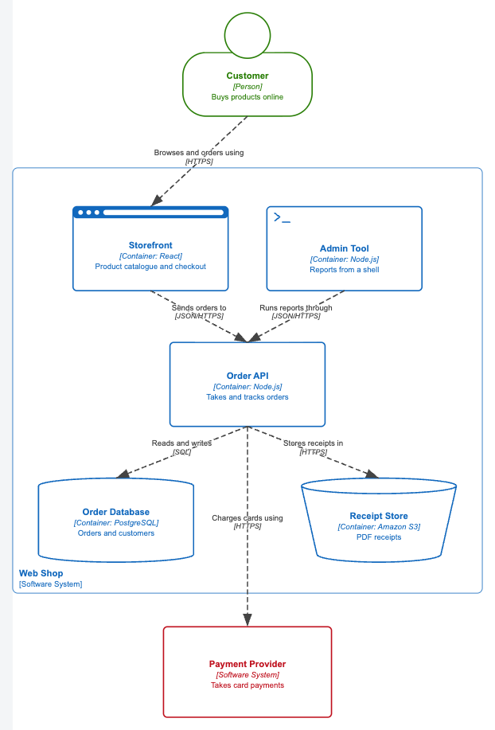
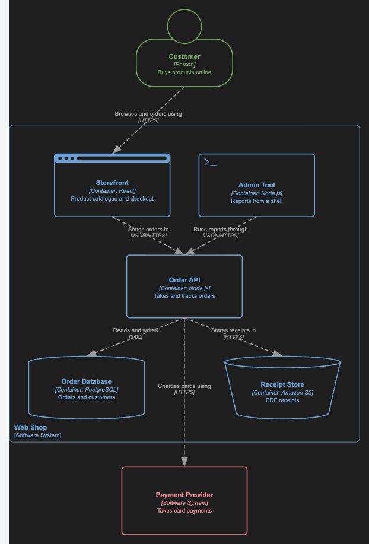
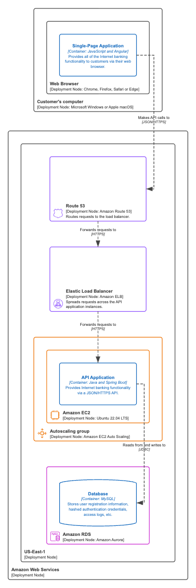
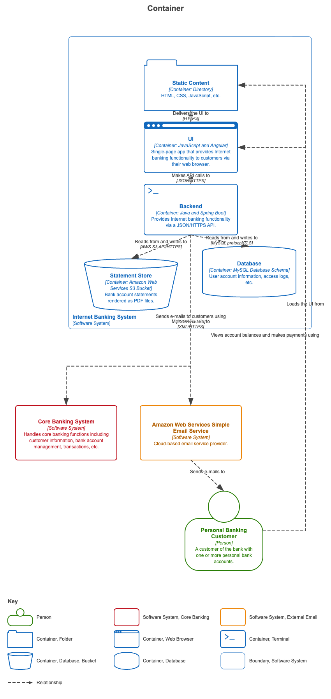
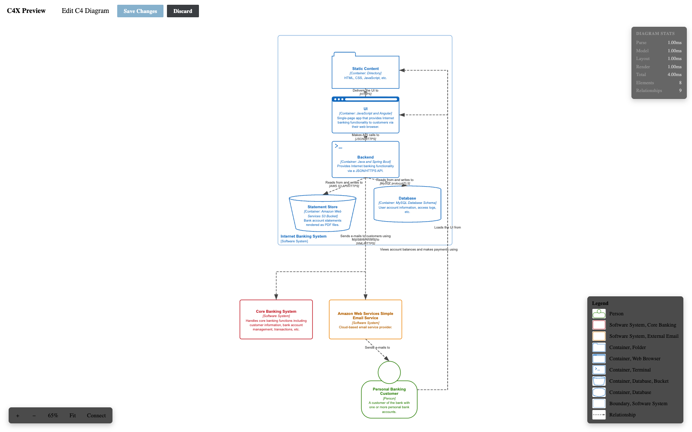

# C4X User Guide

> **Version line**: 1.9.2, released 2026-11-19
> **Updated**: 2026-11-16

C4X renders source-controlled C4 diagrams directly in VS Code without Java, Docker, or a rendering server. Since v1.6 C4X includes the source-authoritative Visual C4 Editor; 1.8.0 added C4 notation lint, component-to-code mapping and conformance checks, and the current Gemini SDK.

## Supported source files

| Source | Extension | Current preview behaviour |
|---|---|---|
| Native C4X | `.c4x` | Parse, model, automatic layout, SVG preview and C4X export commands |
| Structurizr DSL | `.dsl` | Supported subset adapted into the common C4 model |
| PlantUML C4 | `.puml` | Supported C4 macros adapted into the common C4 model |
| Markdown | `.md` | `c4x` fenced blocks render through the Markdown extension path |

Compatibility varies for foreign DSL features. Keep source in version control and review generated output.

## Create a native C4X diagram

Create `banking.c4x`:

```c4x
%%{ c4: system-context }%%
graph TB
    Person(customer, "Banking Customer", "Uses online banking")
    System(banking, "Internet Banking", "Provides account services")
    System_Ext(email, "E-mail System", "Sends notifications")

    customer -->|Uses| banking
    banking -->|Sends notifications through| email
```

Each element shows its name in bold. A person or software system shows its description, the
third argument, as plain text under the name. A container or component shows `[Technology]` in
italics and then its description. Before 1.9.0 a person's or system's description was drawn in
brackets and italics as if it were a technology; diagrams now render it as plain text without
any source change. Editing the description in the Visual C4 Editor's inspector writes it back to
the same argument.

In the `c4-model` theme (from 1.9.0) each element also prints its C4 type on the line under its name,
as the c4model.com examples do: `[Person]`, `[Software System]`, `[Container: Java and Spring Boot]`,
`[Component: Spring MVC Rest Controller]`, `[Deployment Node: Ubuntu 16.04 LTS]`. The type line
replaces the bare `[Technology]` line, an external element shows the type it is declared as, and the
technology, when there is one, follows the type after a colon. The other themes keep their current
look and print `[Technology]` only; the type names are English in every locale. The type line wraps and
fits the box under the rules below, and it does not change where saved elements sit. See
[the type line](c4x-syntax.md#the-element-type-line).

In the `c4-model` theme (from 1.9.0) a boundary is a thin solid frame with its name and a type line
(`[Software System]`, `[Container]`, `[Enterprise]`) at the bottom left, as in the c4model.com examples; the
frame leaves room for the label, and in the Visual C4 Editor the label stays on the frame's bottom edge when
you drag or resize it. The other themes keep the dashed frame with the name at the top left. See
[boundary notation](c4x-syntax.md#boundary-notation).

In the `c4-model` theme (from 1.9.0) deployment diagrams follow the c4model.com deployment examples: a
deployment node prints its name and `[Deployment Node: technology]` at its bottom left, with its icon (32 px)
beside them, and a node that holds other nodes leaves room for that label under them, so nodes nest as deep as
you write them without text overlapping. A node whose icon keeps its vendor colours (the AWS, Azure and
Google Cloud icons) is outlined in that colour; an `elementStyle` `$stroke` still wins. The other themes draw deployment nodes as before. See
[deployment notation](c4x-syntax.md#deployment-notation).

Latin, Greek and Cyrillic text wider than its element wraps inside it (from 1.9.0); text in other scripts, emoji and symbols is drawn on one line as before: the label, `[technology]` and
description break onto more lines and the box grows taller to hold them; its width and its
saved position do not change. In a diagram with saved positions (moved in the Visual C4 Editor,
written as `$x`/`$y`, or in the sidecar layout file) or saved frame geometry, and in edit mode,
no box grows: the layout stays exactly as before and long text is shortened with the full text on
hover. Entering edit mode on a diagram whose boxes grew first redraws it at the standard sizes, so
the first move you save shifts nothing else. Edit mode stays on while you edit inside the same diagram; any other change to the document ends it. Text
that fits stays on one line, so diagrams whose text fits look as before. Each field has a cap (label 3 lines, technology 2, description 6); text beyond it ends
in `…` and the full text shows in a tooltip on it. While you type a long description in
the inspector the canvas re-wraps it inside the current box; after **Save** the box grows to fit
if the diagram has no saved positions.
Limits per element and what breaks where: [long text](c4x-syntax.md#long-text-wraps-inside-the-element).

See the [syntax reference](c4x-syntax.md) and [examples index](EXAMPLES.md) for C1, C2, C3, dynamic, boundary, icon, layout, and pattern examples.

## Draw in the C4 notation (1.9.0)

Select the `c4-model` theme (the `c4x.theme` setting, or **C4X: Change Theme**) and a diagram looks like the examples on c4model.com: a person has a head, a database is a cylinder, a boundary is a thin frame with its type, and each element prints its type. The theme gives default shapes only to a Person and a database; a browser window, a terminal, a bucket or a folder needs `$shape` (or a tag style), and a relationship shows its technology only when you write the quoted technology. `classic` stays the default theme, and a diagram that uses none of the new syntax draws as before.



The source of that picture:

```c4x
%%{ c4: container }%%
graph TB
Person(customer, "Customer", "Buys products online")
System_Boundary(shop, "Web Shop") {
    Container(web, "Storefront", "React", "Product catalogue and checkout", $shape="WebBrowser")
    Container(api, "Order API", "Node.js", "Takes and tracks orders")
    Container(db, "Order Database", "PostgreSQL", "Orders and customers", $shape="Cylinder")
    Container(receipts, "Receipt Store", "Amazon S3", "PDF receipts", $shape="Bucket")
    Container(admin, "Admin Tool", "Node.js", "Reports from a shell", $shape="Terminal")
}
System_Ext(pay, "Payment Provider", "Takes card payments")
customer -->|Browses and orders using| "HTTPS" web
web -->|Sends orders to| "JSON/HTTPS" api
api -->|Reads and writes| "SQL" db
api -->|Stores receipts in| "HTTPS" receipts
admin -->|Runs reports through| "JSON/HTTPS" api
api -->|Charges cards using| "HTTPS" pay
```

- **Shapes.** `$shape="Name"` on an element draws it as a `Person`, `Cylinder`, `Bucket`, `Folder`, `WebBrowser`, `Terminal`, `RoundedBox` or `Box`. Name, technology and description wrap inside the shape. All 19 valid names, and what each is for, are in [element types](C4X-ELEMENT-TYPES.md#shapes).
- **Tag styles.** `elementStyle Queue $shape="Cylinder", $stroke="#BF101D", $border="dashed", $legend="Message queue"` styles every element tagged `Queue` (`$tags="Queue"`). Keys are `$stroke`, `$background`, `$color`, `$shape`, `$sprite`, `$border`, `$strokeWidth` and `$legend`. See [element styles](c4x-syntax.md#element-styles-elementstyle-shape).
- **Relationship technology.** The quoted text after a label, `a -->|Calls| "HTTPS" b`, is drawn under the label as `[HTTPS]`.
- **Type lines, boundaries and deployment nodes.** `c4-model` prints `[Container: React]` under each name, labels a boundary `[Software System]` at its bottom left, and draws a deployment node's icon beside `[Deployment Node: technology]`. The sections above describe each.
- **The key.** Every diagram can show a key of the styles it draws: an overlay in the preview, and below the diagram in exports with `c4x.export.includeKey` ([the diagram key](#the-diagram-key)).
- **Dark variant.** `c4-model` follows the editor's dark theme; the same diagram in dark:



A deployment view in the same theme:



In the editor, type `$` inside an element to complete `$shape`, `$sprite`, `$tags` and `$code`; type `$shape="` to pick a shape; the snippets `container-database`, `container-browser`, `system-boundary`, `rel-tech`, `element-style` and others insert whole lines.

## Open and refresh the preview

With a `.c4x`, `.dsl`, or `.puml` document active, use any of these entry points:

- run **C4X: Open Preview** from the Command Palette;
- use the editor context/title menu;
- press `Ctrl+K V` on Windows/Linux or `Cmd+K V` on macOS.

The preview follows the active supported document and schedules a render when the watched document changes or is saved. While the visual editor holds unsaved staged changes, a render would clear them. These wait until you select **Save Changes** or **Discard**, and keep the draft: a theme change, **C4X: Refresh Preview**, saving the text editor or an autosave when the diagram source has not changed, and an edit to a Markdown file outside the diagram's fence. These do not keep the draft as it is: a change to the diagram source itself (the `.c4x`, `.dsl` or `.puml` text, or the fence body) raises the conflict banner, where you choose to reload, view the diff or rebase; Save is refused if the diagram source changed under the draft (a refused Save keeps your edits on screen and tells you why; **Discard** reloads from source); and switching the preview to another document discards the draft. Run **C4X: Refresh Preview** to request a refresh explicitly.

Parse and render errors are shown inside the preview. If no supported document is active, open one and run the command again.

## Markdown diagrams

Use a fenced `c4x` block:

````markdown
```c4x
%%{ c4: system-context }%%
graph LR
    Person(user, "User", "Uses the application")
    System(app, "Application", "Provides the service")
    user -->|Uses| app
```
````

Open VS Code's built-in Markdown preview. The extension replaces supported C4X fences with rendered SVG.

## Export and presentation commands

| Command | Purpose |
|---|---|
| **C4X: Export Markdown to HTML** | Export the active Markdown document with rendered diagrams |
| **C4X: Export - Preview** | Open a print-oriented document for browser PDF printing |
| **C4X: Export Diagram as PNG** | Export the current rendered diagram as PNG |
| **C4X: Export SVG** | Save the current SVG |
| **C4X: Copy SVG To Clipboard** | Copy SVG source |
| **C4X: Change Theme** | Select a supported diagram theme |
| **C4X: Reset Visual Layout** | Remove native layout metadata or the selected sidecar overrides |

If an SVG-based export command has no current rendered diagram, it can offer to open the preview first.

The save dialog opens in the folder of the source file and suggests the same base name:

- **Export SVG** and **Export Diagram as PNG**: `docs/shop.c4x` suggests `docs/shop.svg` or `docs/shop.png`.
- **Export Markdown to HTML**: `docs/shop.md` suggests `docs/shop.html`.

What each export needs:

- **Export SVG** works from the open preview. If a local file is the active editor, its folder and name are used; if not, it suggests `diagram.svg` in the first workspace folder, or leaves the location to VS Code when no folder is open.
- Exports show the diagram as the preview shows it outside edit mode: boxes grown to fit long text where the diagram has no saved positions, even when you export while editing.
- An exported SVG draws its text exactly as the preview does: bold names, 12 px technology and descriptions (11 px under an icon), wrapped lines included. Before 1.9.0 the file's stylesheet drew every text at the theme's base size and regular weight.
- **Export Diagram as PNG** needs a C4X, Structurizr DSL or PlantUML file as the active editor (a `.c4x`, `.dsl` or `.puml` file, or any file set to one of those language modes), and otherwise shows "Open a .c4x, .dsl, or .puml file before exporting a PNG."
- **Export Markdown to HTML** needs a Markdown file as the active editor, and otherwise shows "No markdown file selected or open".

### The diagram key

c4model.com asks every diagram for a key. C4X builds it from the styles the diagram actually draws: one entry per distinct element style (type, tags, shape and colour), then one per boundary type and one per relationship line style. Each entry has a swatch drawn in the element's own shape, so a folder in the diagram is a folder in the key.

- **In the preview** the key is an overlay at the bottom right of the canvas. Drag it, or Tab to it and use the arrow keys. A screen reader announces it as the diagram legend and reads each entry. **Fit** and auto-fit on open keep every element clear of the key while it sits in its corner. A long key takes at most 40% of the canvas height and scrolls: Tab to its list and use the arrow keys. A tag you change in the visual editor shows in the key at once, before Save. A diagram with more than 128 styles lists the first 127 and says how many more there are.
- **In exports** turn on `c4x.export.includeKey`. Export SVG, Export Diagram as PNG, Copy SVG To Clipboard, Export Markdown to HTML, the print preview for PDF and the Markdown preview then add the key below the diagram. It is off by default, and with it off every export is exactly what it was before.

How an entry is labelled:

1. The `$legend` text of the tag style that styled it, if there is one (`elementStyle Mainframe $legend="Mainframe (legacy)"`).
2. Otherwise the element type, then the tags whose `elementStyle` styled it (`Container, Queue`), then the element's own `$shape` when that changed the outline (`Container, Folder`).
3. When two entries would still read the same, C4X adds each element's other tags (`Software System, Core Banking`), and as a last resort a number.





### Key and export settings

| Setting | Default | Effect |
|---|---|---|
| `c4x.legend.show` | `true` | Show the key overlay in the preview. |
| `c4x.export.includeKey` | `false` | Add the key below the diagram in SVG, PNG, PDF and HTML exports, Copy SVG and the Markdown preview. Read when each export runs, so a change applies to the next export. |

## Architecture conformance

A component (C3) view says which components may depend on which. C4X can turn it into rules that
your own CI runs, so the build fails when the code grows a dependency the diagram does not
declare. C4X does not bundle a checker: it writes the rules, and it explains the checker's
result on the `.c4x` lines.

1. **Map components to code.** Add `$code="..."` to each Component or Container, with
   workspace-relative globs (see [Code Mapping](c4x-syntax.md#code-mapping-code)):

   ```c4x
   %%{ c4: component }%%
   graph TB
       Component(api, "HTTP API", "Node.js", "Routes requests", $code="src/api/**")
       Component(orders, "Orders", "Node.js", "Order rules", $code="src/orders/**")
       Component(store, "Store", "Node.js", "Persistence", $code="src/store/**")
       api -->|places orders through| orders
       orders -->|persists with| store
   ```

2. **Export the rules.** With the `.c4x` file active, run
   **C4X: Export Architecture Conformance**. It writes `.dependency-cruiser.c4x.json` at the
   workspace root: a [dependency-cruiser](https://github.com/sverweij/dependency-cruiser)
   allow-list with one rule per declared relationship (`a --> b` means code in `a` may import
   code in `b`), one rule per component allowing imports within itself, and a pass-through for
   imports outside the mapped folders (packages, Node built-ins). Components without `$code`,
   and relationships that touch them or a Person or Software System, produce no rule; the
   **C4X Conformance** output channel lists every one of them.

3. **Run the checker in CI**, from the workspace root, on Node 22 or later. For CI, install the
   checker and TypeScript as exact-pinned development dependencies, so your lockfile fixes what
   runs and a registry change cannot alter your gate:

   ```bash
   npm install --save-dev --save-exact dependency-cruiser@18.4.0 typescript@5.9.3
   npx depcruise src --config .dependency-cruiser.c4x.json --output-type err
   ```

   dependency-cruiser parses TypeScript only when `typescript` is installed beside it. Without it,
   a TypeScript project is cruised as almost no modules and passes, which is why both are pinned.
   To try it once without installing anything, the export's **Copy Run Command** gives the
   equivalent one-off form, which downloads both at those versions:

   ```bash
   npx --yes -p dependency-cruiser@18.4.0 -p typescript@5.9.3 depcruise 'src' --config .dependency-cruiser.c4x.json --output-type err
   ```

   Use `--output-type err` (or read `summary.error` from JSON) as the gate: the `json` reporter
   exits 0 whatever it finds. Any import the view does not declare fails as `not-in-allowed`.
   Test files (`__tests__/`, `*.test.*`, `*.spec.*`) are excluded, and `import type` counts as a
   dependency.

4. **See the result on the diagram.** Save the checker's JSON result
   (`--output-type json > depcruise.json`) and run
   **C4X: Check Architecture Conformance from dependency-cruiser Result** with the `.c4x` file
   active. Findings appear in the Problems panel on the `.c4x` lines:

   | Finding | Severity | Where |
   |---|---|---|
   | Undeclared dependency (`not-in-allowed`, or an import between components that no relationship declares) | Error | The source component's line, listing the imports |
   | A file in the checked folders that no `$code` maps | Error | Line 1 |
   | The result covers no mapped module, or under half of the mapped source files on disk | Error | Line 1 |
   | A component none of whose files were cruised | Warning | The element's line |
   | Components that form a dependency cycle in the code | Warning | The first component of the cycle |
   | A declared relationship no import uses | Warning | The relationship's line |
   | A Component or Container without `$code` | Information | The element's line |

   The checker reports neither cycles between components nor relationships the code never uses;
   C4X computes both from the module graph in the JSON result. It also checks every import in
   that graph against the view itself, so a stale `.dependency-cruiser.c4x.json` cannot let an
   undeclared dependency through, and it compares the modules cruised with the files your
   `$code` globs match, so a run that silently parsed nothing fails. The findings describe the text
   they were computed from, so editing the file clears them.

## C4X tools for the chat agent (MCP)

From 1.9.0, on VS Code 1.101 or later, the extension offers a C4X MCP server to VS Code's chat agent with no setup.

- **What appears.** One server named `C4X` with three tools: `validate_c4x` (reports syntax errors with line and column), `lint_c4x` (reports C4 notation findings) and `render_c4x` (draws the diagram as SVG with the preview's own renderer, so the agent can check what it wrote). Open Chat in Agent mode and use the tools picker to see them. The server reads only the text the agent sends it and returns text.
- **No prompt.** VS Code treats a server an extension provides as trusted, so on the VS Code versions checked (1.101.0, 1.105.0 and 1.128.0) it shows no separate first-start prompt: once the extension is installed, the built-in agent can use the tools. VS Code, not C4X, starts the server, and only when an agent session first needs it. Run **MCP: List Servers** to see its state, stop it or read its output.
- **What it can do.** The server receives only the text the agent sends it and returns text. It opens no network connection, starts no process and writes no file.
- **Where it is offered.** Not in virtual workspaces, in the browser, or in an untrusted workspace (it appears once you trust the workspace).
- **Turn it off.** Set `c4x.mcp.register` to `false` in Settings. C4X then offers no server, and the change applies without a reload. You can also disable the server from VS Code's MCP server list (Chat customizations, MCP Servers).
- **Which VS Code.** 1.101 or later. On an older VS Code the extension works as before and offers no server.
- **Try it.** In Agent mode ask: "Write a C4 container view for a web shop with a React front end, an order API and a PostgreSQL database. Check it with the C4X tools and fix anything they report."
- **See the picture.** Ask: "Render it with render_c4x in the c4-model theme and tell me what the diagram shows." The tool returns the SVG as a separate `image/svg+xml` item, with any findings in a text item before it. Outside VS Code the same render is `node cli/c4x.cjs render diagram.c4x -o diagram.svg`; see [Render C4X outside VS Code](C4X-RENDER.md).

Other editors and agents use the same server from the file in the repository; see the README section "MCP server".

## Command-line tools from npm

From 1.9.0 the MCP server and the two command-line tools (`c4x render`, `c4x-lint`) are packaged as the npm package `c4x`, for use in a coding agent or CI without VS Code. The package is not on the registry yet: the maintainer publishes it, and until then it cannot be installed with `npm install`. What it holds and how it is checked: [Install the C4X tools from npm](C4X-NPM.md).

## Gemini-assisted commands

Gemini features are optional and require their documented configuration. They are separate from deterministic local parsing and preview:

- **C4X: Generate Diagram Here (Gemini)**;
- **C4X: Diagram from Selection**;
- **C4X: Preview - Visual Diagram (PNG)**.

From 1.9.0 generated source asks for the current notation: `$shape` for data stores, queues, browsers and command-line tools, the technology after each relationship label, and boundary types. Generated images take their colours from the theme you selected (`c4x.theme`). An unknown `$shape` is sent back to the model with the closest valid name.

Review AI-generated source or images before committing them. See the [Gemini guide](GEMINI_GUIDE.md).

The first two commands can use a chat model you already have in VS Code instead of a Gemini key: set `c4x.ai.provider` to `vscode-lm` and choose a model with **C4X: Select AI Model**. C4X asks you to confirm the model and shows what it will send before each generation. See [Generate with a VS Code model](GEMINI_GUIDE.md#without-a-gemini-key-use-a-vs-code-model).

## Visual Layout Mode status

The Visual C4 Editor is available since v1.6 and in the current 1.9.2 release. It provides source-controlled drag, keyboard movement, staged native property editing with inline validation, safe identifier rename, relationship creation and editing, boundary editing, lock toggling, reset, native C4X writeback, and deterministic sidecar persistence for foreign formats.

Follow the maintainer guide "How to edit a C4 diagram visually" (`docs/how-to/`, not in the public repository) for entering edit mode, pointer and keyboard movement, zoom/pan, persistence selection, reset, and recovery. Changes are staged and applied together with **Save Changes**; **Discard** abandons the draft. Source or an explicit versioned sidecar remains authoritative.

See the maintainer capability matrix and Known Limitations (`docs/features/`, not in the public repository) for the verified boundary and the planned semantic-editor journey. Native `.c4x` preview supports a staged property inspector and safe identifier rename; Markdown C4X fences expose the same staged editor through a CodeLens, the editor context menu, and the Markdown Preview toolbar (B18). Boundaries declared with `System_Boundary`, `Container_Boundary` or `Enterprise_Boundary` cannot be dragged or resized, because that syntax has no place for a position or size; their frame follows their contents, and hovering one in edit mode says so. A boundary written as `subgraph` can be moved and resized, but it loses its C4 type: the nesting-legality and `Container_Boundary` lint checks no longer apply to it. Source-diff review (#83) and session-level conflict recovery (#71) are implemented. Creating a relationship, connecting two elements and changing a relationship's endpoint are supported. Adding an element from a palette and deleting elements or relationships are planned and not in this release.

## Troubleshooting

### Preview does not open

- Confirm the active file is `.c4x`, `.dsl`, or `.puml`.
- Run **C4X: Open Preview** from the Command Palette.
- Check the Problems and Extension Host output for activation errors.

### Preview reports a parse error

- Check the view directive and `graph` declaration for native C4X.
- Reduce the file to the smallest failing example.
- Compare it with the [syntax reference](c4x-syntax.md).

### Layout is unclear

- Choose an explicit `TB`, `BT`, `LR`, or `RL` graph direction.
- Shorten very long labels.
- Split diagrams that mix multiple abstraction levels.
- Use the [layout examples](EXAMPLES-LAYOUT.md).

### Markdown preview does not render

- Use a `c4x` fenced code block exactly.
- Confirm the C4X extension is active.
- Reload the Markdown preview after correcting syntax.

For additional cases, see [Troubleshooting](TROUBLESHOOTING.md) and the [FAQ](FAQ.md).
