# C4X-DSL Syntax Reference

**Version**: 1.0.0
**Last Updated**: 2025-12-01

## Overview

> **Generated reference.** Every element type and argument order, every `elementStyle` key and shape, every lint rule, the text-length limits and examples that lint clean are in the [generated C4X reference](reference/c4x-reference.md), also as [machine-readable JSON](reference/c4x-reference.json). It is built from the grammar and the catalogues by `pnpm run generate:reference`, so it cannot drift from the parser. Where this page and the reference differ, the reference is right.

C4X-DSL is a Mermaid-inspired language for creating C4 Model diagrams. It provides a simple, text-based way to define elements, relationships, and boundaries for System Context, Container, and Component diagrams.

## Why Use C4X-DSL?

- **Familiarity**: If you know Mermaid, you'll feel right at home.
- **Simplicity**: Create complex diagrams with minimal boilerplate.
- **Offline-First**: Renders instantly in VS Code with no external dependencies.
- **C4-Native**: Designed specifically for the C4 Model, with first-class support for its concepts.

## v1.0 Status & Capabilities

### ✅ **Production Ready**

- **System Context (C1)**: Full support with elements, relationships, and themes.
- **Container & Component**: Full support with visual boundaries (`subgraph`).
- **Element Types**: Person, Software System, Container, Component.
- **Relationship Arrows**: `-->` (sync), `-.->` (async), `==>` (strong).
- **Graph Directions**: `TB`, `BT`, `LR`, `RL`.
- **Tags**: External, Internal, technology tags.
- **Performance**: ~10ms parse time, ~55ms total render.

---

## Core Concepts

A C4X diagram is defined in a `.c4x` file and consists of three main parts:

1. **View Declaration**: Specifies the diagram type (e.g., `system-context`).
2. **Graph Direction**: Sets the layout orientation (e.g., `graph TB` for top-to-bottom).
3. **Diagram Body**: Contains element and relationship definitions.

### Basic Structure

```text
%%{ c4: <view-type> }%%
graph <direction>
    <elements>
    <relationships>
```

---

## View Declaration

The view declaration is a processing instruction that tells the C4X renderer what type of diagram to create.

**Syntax**: `%%{ c4: <view-type> }%%`

### Supported View Types

| View Type | C4 Level | Description | Status |
|---|---|---|---|
| `system-context` | C1 | Shows the system and its interactions with users and other systems. | ✅ **Production** |
| `container` | C2 | Zooms into a system to show its containers (applications, databases, etc.). | ✅ **Production** |
| `component` | C3 | Zooms into a container to show its components. | ✅ **Production** |
| `deployment` | C4 | Shows how software maps to infrastructure. | 🚧 **Preview** |

### Example

```text
%%{ c4: system-context }%%
```

---

## Graph Direction

C4X uses the same graph direction keywords as Mermaid's flowchart diagrams.

**Syntax**: `graph <direction>`

### Supported Directions
C4X supports all Mermaid direction keywords. Choose the one that best fits your narrative:

| Direction | Best For | Description |
|---|---|---|
| `TB` | **Hierarchy** | (Top-Bottom) Default for Context and Container diagrams. Shows structural decomposition. |
| `LR` | **Flow** | (Left-Right) Best for sequences, data pipelines, or process flows. |
| `BT` | **Upstream** | (Bottom-Top) Useful for visualizing dependency inversions. |
| `RL` | **Reverse** | (Right-Left) Rarely used, but available. |

### Guidance: TB vs LR
*   **Use `TB`** when you want to show "What is contained in what?". It naturally represents layers.
*   **Use `LR`** when you want to show "How does data move?". It naturally represents a timeline or pipeline.

### Example
```text
graph LR
```

### Controlling Layout
You can influence the relative positioning of elements by changing the **order of relationship definitions**.
In a `TB` (Top-Bottom) graph:
*   Relationships defined **first** appear on the **left**.
*   Relationships defined **later** appear on the **right**.

**Example**:
```c4x
%%{ c4: container }%%
graph TB
  App[App<br/>Container]
  DB1[DB 1<br/>Container]
  DB2[DB 2<br/>Container]
  
  %% DB1 will be on the LEFT
  App --> DB1
  App --> DB2
```

To swap them, just swap the lines:
```text
  App --> DB2
  App --> DB1
```

Elements are the building blocks of your C4 diagram. They represent people, software systems, containers, or components.

**Syntax**: `ElementID[Label<br/>Type<br/>Tags]`

### Element Properties

- **`ElementID`**: A unique identifier for the element within the diagram. It is not displayed in the diagram itself but is used to define relationships.
- **`Label`**: The display name of the element.
- **`Type`**: The C4 element type.
- **`Tags`** (optional): Additional metadata for styling or grouping.

### Supported Element Types

| Type | C4 Level | Description |
|---|---|---|
| `Person` | C1, C2, C3 | A user of the system. |
| `Software System` | C1, C2, C3 | A high-level software system. |
| `Container` | C2, C3 | A deployable unit like an application or database. |
| `Component` | C3 | A code-level component or module. |

### Tags

Tags provide extra information about an element.

- **`External`**: Marks the element as being outside the scope of the system you are modeling.
- **`Internal`** (default): Marks the element as being inside the system scope.
- You can also add technology tags, like `React` or `PostgreSQL`.

### Examples

#### Basic Person Element

```text
Customer[Customer<br/>Person]
```

#### Software System with External Tag

```text
EmailSystem[Email System<br/>Software System<br/>External]
```

#### Container with Technology

```text
WebApp[Web Application<br/>Container<br/>React]
```

---

## Relationships

Relationships define the interactions between elements.

**Syntax**: `FromID -->|Label| ToID`, or with a technology: `FromID -->|Label| "Technology" ToID`

### Relationship Properties

- **`FromID`**: The `ElementID` of the source element.
- **`ToID`**: The `ElementID` of the target element.
- **`Label`**: A description of the relationship (e.g., "Uses", "Sends emails to").
- **`"Technology"`** (optional): The protocol or mechanism, in quotes after the label (e.g., `"HTTPS"`, `"gRPC"`). The preview and exported SVG draw it as `[Technology]` in italics on a second line under the label, in every theme (from 1.9.0; before that it was kept and linted by C4X-L004 but not drawn). A relationship without one draws as before.

### Arrow Types

C4X supports different arrow styles to represent different types of interaction.

| Arrow | Description |
|---|---|
| `-->` | A standard synchronous relationship. |
| `-.->` | An asynchronous relationship. |
| `==>` | A strong dependency or data flow. |

### How arrows are drawn

An arrow runs from the nearest side of its source to the nearest side of its target. When that straight line would cross another element, C4X routes the arrow around it instead: horizontal and vertical segments that keep a small gap from every box, ending square-on to the target. Arrows may still cross a boundary frame or a parent box (a deployment node, a container with components) to reach an element inside it. If no route fits inside the canvas, or the diagram is too large for the route search (a few hundred elements), the arrow keeps the candidate that crosses the least, usually the straight line, and may then cross a box. Positions you save with the visual editor are respected: the route is worked out after them.

While you drag an element in the visual editor, its arrows are drawn straight to the nearest sides so they follow the pointer. If you cancel the drag or bring the element back to where it was, the routed arrows come back as they were; otherwise the diagram is routed again when the preview re-renders after **Save Changes**. The two arrows of a two-way relationship get a lane each; where there is no room for two lanes they share one route rather than cross a box.

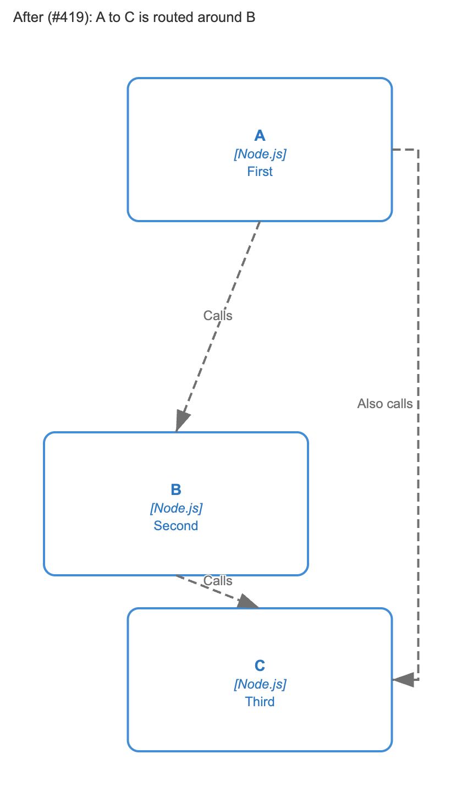

### Examples

#### Synchronous Relationship

```text
Customer -->|Uses| BankingSystem
```

#### Asynchronous Relationship

```text
WebApp -.->|Sends events to| MessageBus
```

#### Relationship with Technology

```text
WebApp -->|Reads orders from| "HTTPS" Api
```

![A labelled arrow with its technology, [HTTPS], on a second line under the label](./images/edge-technology/421-after.png)

---

## Boundaries / Subgraphs (Containers & Components)

You can group elements into boundaries (representing a System or Container context) using the `subgraph` syntax.

**Syntax**:

```text
subgraph BoundaryID
    Element1[...]
    Element2[...]
end
```

### Example: Container Diagram

```c4x
%%{ c4: container }%%
graph TB
    Customer[Customer<br/>Person]

    subgraph BankingSystem {
        WebApp[Web App<br/>Container]
        API[API<br/>Container]
        Database[DB<br/>Container]
    }

    Customer -->|Uses| WebApp
    WebApp -->|Calls| API
    API -->|Queries| Database
```

---

## Advanced Syntax (v1.2 Preview)

### Deployment Diagrams (Nodes)

Deployment diagrams visualize the mapping of software containers to infrastructure nodes. C4X introduces a `Node` block syntax for recursive nesting.

**Syntax**: `Node(ID, "Label", "Technology") { ... }`

```c4x
%%{ c4: deployment }%%
graph TB
    Node(aws, "AWS", "Cloud") {
        Node(region, "US East", "Region") {
             Container(api, "API", "Java")
        }
    }
```

### Functional Element Definitions

You can also define elements using a functional syntax, similar to other C4 tools.

**Syntax**: what the positional arguments after the label mean depends on the element kind.

| Kind | Arguments | Drawn as |
|---|---|---|
| `Person`, `Person_Ext`, `System`, `System_Ext`, `SystemDb`, `SystemDb_Ext` | `(ID, "Label", "Description")` | Name in bold, then the description as plain text |
| `Container`, `ContainerDb`, `Component`, `ComponentDb` and their `_Ext` variants, `Node` | `(ID, "Label", "Technology", "Description")` | Name in bold, `[Technology]` in italics, then the description as plain text |

Key-value arguments such as `$tags="..."` and `$sprite="..."` follow the positional ones.

```c4x
Container(webApp, "Web App", "React", "User Interface", $tags="frontend", $sprite="react")
```

```c4x
%%{ c4: system-context }%%
graph TB
    Person(customer, "Personal Banking Customer", "Views balances and pays bills")
    System(banking, "Internet Banking System", "Shows accounts and takes payments")
    System_Ext(mainframe, "Mainframe Banking System", "Holds customer accounts")
    customer -->|Views balances and pays bills using| banking
    banking -->|Gets account details from| mainframe
```

A person or software system has no technology line on c4model.com, so C4X draws its third
argument as the description. Before 1.9.0 C4X drew it as `[Description]` in the technology
style; existing diagrams now render it as plain text with no source change. To give a person or
system a technology as well, write both: `System(legacy, "Ledger", "Mainframe", "Holds accounts")`.
A runnable example is [`samples/system-context/person-and-system-descriptions.c4x`](../samples/system-context/person-and-system-descriptions.c4x).

| Before 1.9.0 | From 1.9.0 |
|---|---|
| 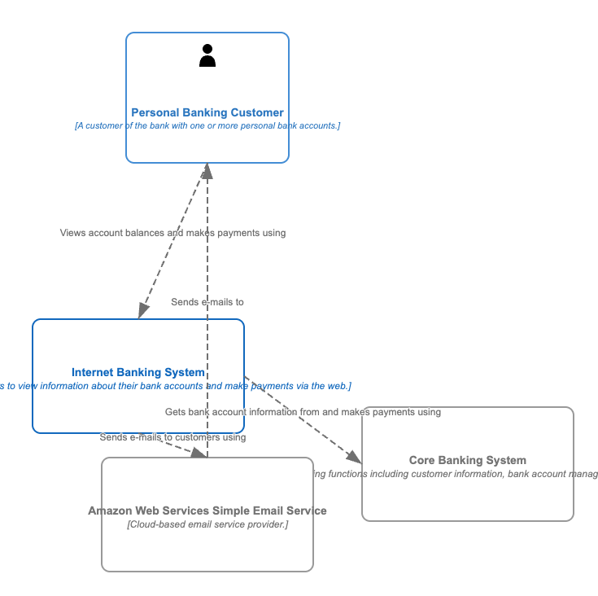 |  |

### Long text wraps inside the element

From 1.9.0 a label, `[technology]` or description that is wider than its element breaks onto
more lines inside the shape, in every theme, in the preview, the Visual C4 Editor and every
export (SVG, PNG, HTML, PDF). Before, it was drawn as one line that ran past the box, over its
neighbours and off the canvas.

- **What wraps.** Only text in Latin (with its extensions and IPA), Greek or Cyrillic, with
  ordinary punctuation and spaces, and only when it is wider than the element's text area (the box
  less 8 px each side). Width is measured as drawn: runs of spaces, tabs and line breaks count as
  one space, as in any SVG; no-break and other Unicode spaces are drawn as they are. Text that fits
  is drawn on one line exactly as before.
- **Other scripts are not wrapped yet.** Text containing any other character (Hebrew, Arabic and
  other right-to-left scripts or bidirectional controls, Thai, Devanagari, Chinese, Japanese,
  Korean, emoji and emoji sequences, symbols such as ✓ ♠ ⚙, or combining marks) is drawn exactly
  as in 1.8, on one line, however long. Keep such text short, or wrap it yourself into shorter
  fields. Measured wrapping for these scripts is planned.
- **Where it breaks.** Between words. A word wider than the line, such as a URL or a long
  identifier, breaks after `/ - . _ , ; : ? & =` and similar characters, or between letters when
  it has none. A line break inside a quoted string counts as a space; there is no forced line
  break.
- **The box grows taller, never wider.** Widths stay per element type (person 200 px, software
  system 260, container 240, component 220). In a diagram with no saved positions the box grows
  downward to hold the lines and the layout makes room for it (see saved layouts below).
- **The cap.** At most 3 lines of label, 2 of technology and 6 of description. Text beyond the
  cap ends in an ellipsis (`…`); the full text is in a tooltip on the cut text and in the inspector.
- **Saved layouts.** Pinned elements never move and never grow into another element or frame.
  In a diagram that carries any saved geometry (an element `$x`, `$y` or `$locked`, in the source
  or in the sidecar layout file, or a `subgraph` `$x`, `$y`, `$w` or `$h`), no box grows: every
  box keeps its standard size, so the layout is exactly what it was before 1.9.0. Long text still
  wraps inside the box, and text that does not fit is shortened with an ellipsis; the full text
  shows on hover. Boxes grow only in diagrams that C4X lays out entirely by itself, and only in
  view mode.
- **Edit mode.** Edit mode stays on while you edit inside the same diagram; any other change to
  the document ends it. In the Visual C4 Editor's edit mode boxes keep their standard size and long text
  is shortened, with the full text on hover. Entering edit mode on a diagram whose boxes grew
  redraws it at the standard sizes first, so the layout you drag on is the one Save produces: the
  first move you save does not shift anything you did not move. Leaving edit mode without saving
  lets the boxes grow again. Moving and resizing are possible only once the standard-size layout
  is on screen; until then the status line says the editor is preparing. A draft restored after
  the preview reloads is put back onto the standard-size layout. Exports always show the diagram
  as the preview shows it outside edit mode.
- **The text area.** No line of wrapped text is wider than the box less 8 px on each side, by the
  width model (with a 3 % margin for its error on wrapped lines). Under a person or an icon text
  starts below the icon; in a database cylinder it keeps clear of the lid and the base.

Roughly how much fits, in the default Arial themes (Georgia in `muted` and monospace in `auto`
are wider, so they wrap sooner):

| Element | One line up to | Wrapped, per line | Description cap |
|---|---|---|---|
| Person (11 px text) | about 37 characters | about 36 | 6 lines, about 215 characters |
| Software system | about 45 | about 44 | about 260 |
| Container | about 41 | about 40 | about 240 |
| Component | about 38 | about 37 | about 220 |

Labels are bold 14 px: about 27 characters on one line in a person, 35 in a software system, 33
in a container and 30 in a component. To keep a diagram compact, write descriptions of one
short sentence; to keep it on one line, stay under the first column. A runnable example is
[`samples/container/long-text-wrapping.c4x`](../samples/container/long-text-wrapping.c4x).

| Before 1.9.0 | From 1.9.0 |
|---|---|
| 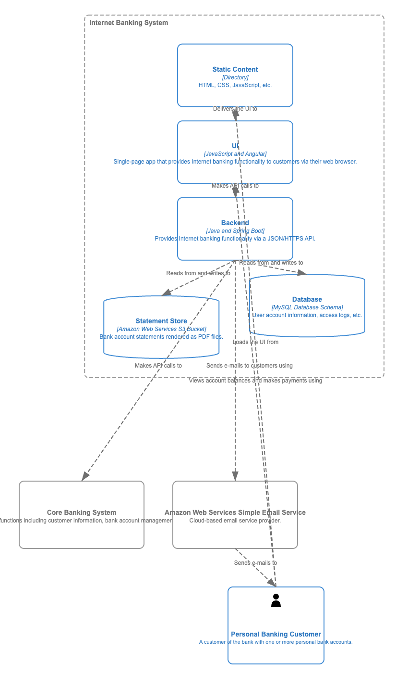 | 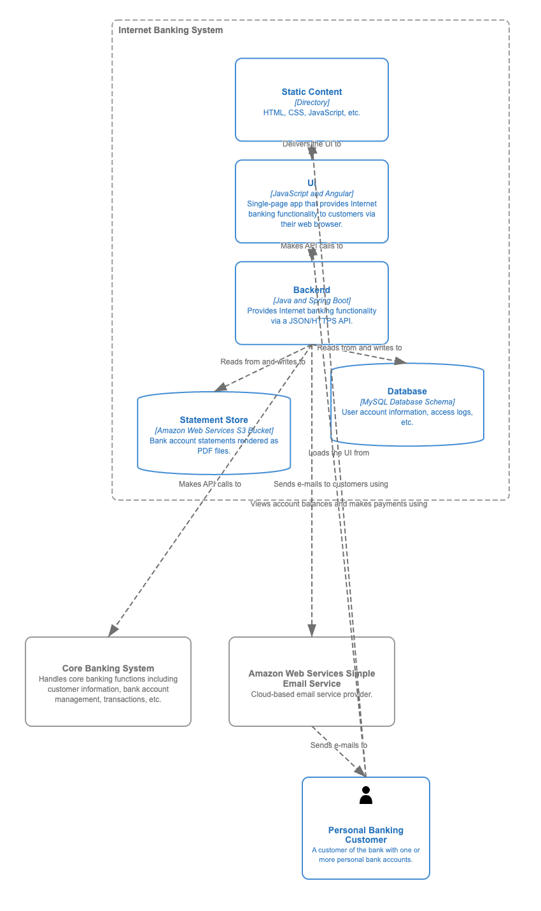 |
| 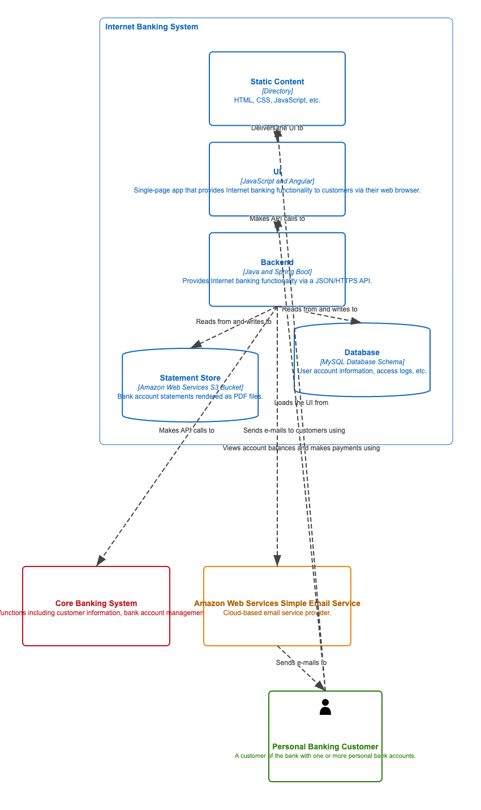 |  |

### The element type line

In the `c4-model` theme every element prints its C4 type under its name, in italics, in place of
the bare technology line (from 1.9.0): `[Person]`, `[Software System]`, `[Container]`,
`[Component]`, `[Deployment Node]`, and with a technology `[Container: Java and Spring Boot]`.
An external system or container reads as its type (`System_Ext` prints `[Software System]`).
Other themes print `[Technology]` only, as before. The type names are not translated.

The type line is drawn by the same text measuring and wrapping as any other element text: it
counts toward the technology field's 2-line cap, wraps at the element's inner width only when
it is made entirely of Latin, Greek or Cyrillic text, and is drawn on one line otherwise. In a
diagram with no saved positions the box grows to hold a wrapped type line; in a diagram with saved
positions or frames nothing moves and an over-long line is shortened with the full text on
hover. A theme turns the line on with the `showElementType` token.

| Before | After |
|---|---|
| 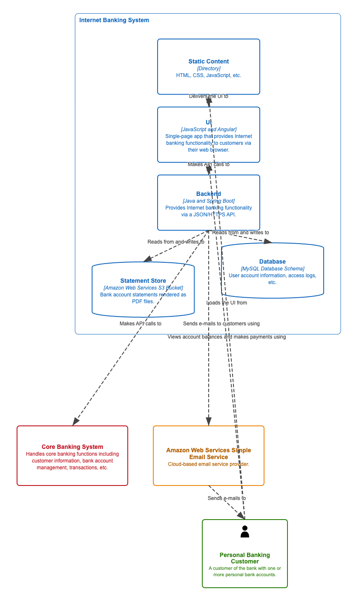 | 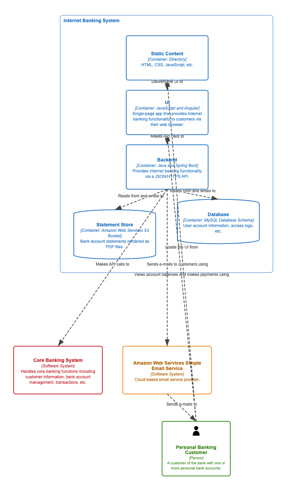 |
|  | 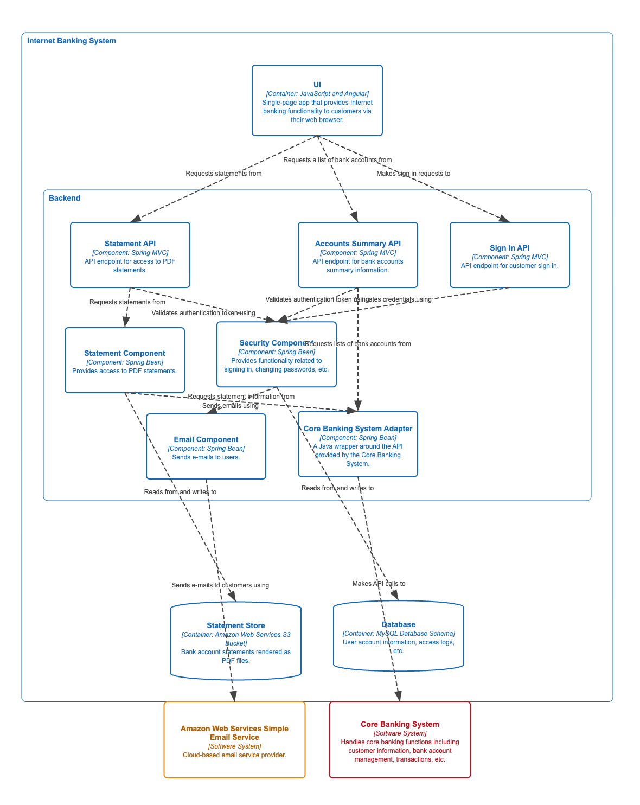 |

### Boundary notation

In the `c4-model` theme (from 1.9.0) a boundary is drawn as the c4model.com examples draw it: a thin
solid rounded rectangle in the theme's boundary colour (`#1168BD`, lighter in the dark variant), with
its name in bold and, under the name, a type line, both at the bottom left. The type line comes from
the keyword that declared the boundary: `System_Boundary` prints `[Software System]`,
`Container_Boundary` prints `[Container]` and `Enterprise_Boundary` prints `[Enterprise]`. A
`subgraph` boundary states no C4 type, so it prints its name only. The type line is not translated.

The other themes keep their dashed frame with the name at the top left and no type line. A theme
chooses with its `boundary` tokens: `labelPosition` (`top-left` or `bottom-left`) and `showType`.

The frame leaves room for the label. A bottom-left label sits under the lowest element or nested
frame, and a frame narrower than its measured label widens to hold it, so no element, nested frame
or relationship label is drawn over the label. In the Visual C4 Editor the label stays on the frame's
bottom edge when the frame is dragged, resized or re-wrapped around a moved element.

| c4-model, light | c4-model, dark |
|---|---|
| 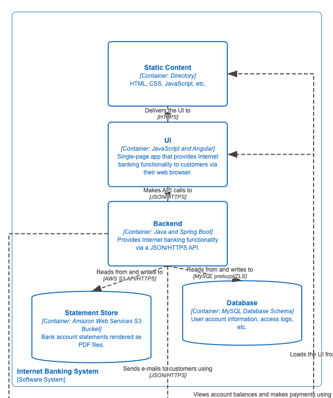 | 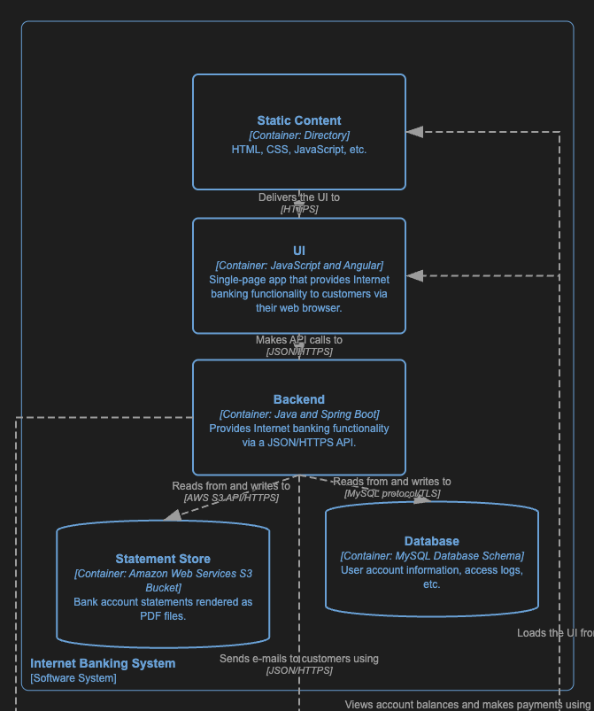 |

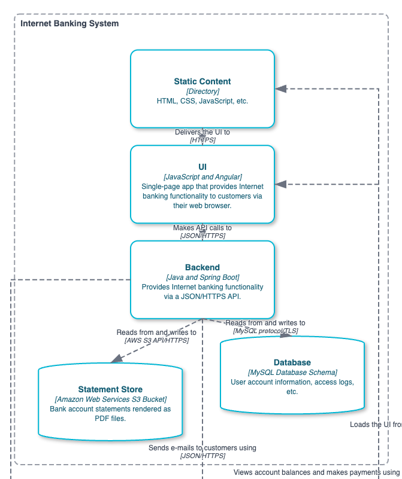

### Deployment notation

In the `c4-model` theme (from 1.9.0) deployment nodes are drawn as the c4model.com deployment examples draw
them:

- A deployment node prints its name in bold and `[Deployment Node: technology]` under it, at its bottom
  left. Its icon, when it has a `$sprite`, is drawn 32 px wide beside the name, at the bottom left, instead
  of 40 px at the top centre. A description, when there is one, is a third line.
- A node with no children (a single service such as a DNS zone or load balancer) uses the same label row.
- A node that holds other nodes or containers leaves room for that label under them and is at least as wide
  as its label (up to 480 px; a longer label wraps), so nodes nest as deep as you write them and no child,
  sibling or relationship label is drawn over a node's label. Relationship lines are routed around a label
  they do not start or end at.
- A node whose icon keeps its own colours (the bundled AWS, Azure and Google Cloud icons) is outlined in the
  icon's main colour. The text keeps the theme colour. An `elementStyle` `$stroke` for one of the node's tags
  replaces the tint.

The Visual C4 Editor redraws a node's label in the same place when you edit its name, technology or
description, and the SVG, PNG, HTML and PDF exports draw every icon where the preview does. The other
themes keep the earlier drawing: icon 40 px at the top centre and the label under it. A theme turns the
notation on with its `deploymentNotation` token (`brandTint` switches the outline tint).

| c4-model, light | c4-model, dark |
|---|---|
|  | 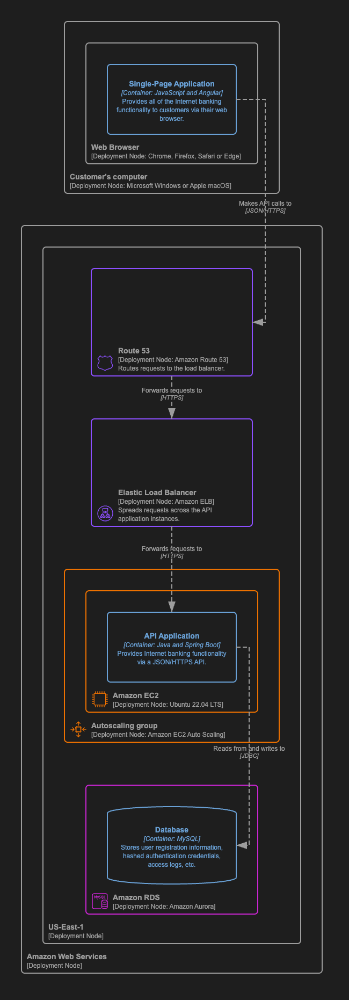 |

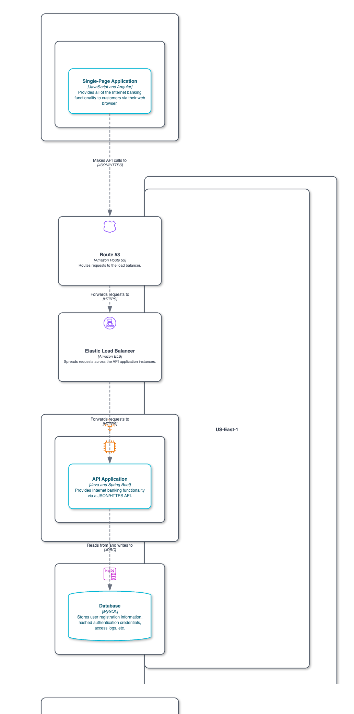

### Key-Value Arguments

Elements now support optional key-value arguments for advanced customization.

- `$tags="tag1, tag2"`: Comma-separated tags.
- `$sprite="icon-name"`: Icon identifier (for future icon support).
- `$code="glob, glob"`: Where a Container or Component lives in source code. See [Code Mapping](#code-mapping-code).

### Code Mapping (`$code`)

A Container or Component can say which source files it owns. The mapping is what
**C4X: Export Architecture Conformance** turns into dependency rules, so a team's CI can check
that the code still has only the dependencies the diagram declares.

**Syntax**: `$code="<glob>[, <glob> ...]"` as a key-value argument.

```c4x
%%{ c4: component }%%
graph TB
    Container_Boundary(host, "Extension host") {
        Component(entry, "Extension entry", "TypeScript", "Composition root", $code="src/extension.ts")
        Component(parser, "Parsers", "Peggy", "C4X grammar and adapters", $code="src/parser/**")
        Component(core, "Model and layout", "TypeScript", "Shared model", $code="src/{model,layout}/**")
    }
    entry -->|parses with| parser
    parser -->|builds| core
```

Rules:

- **Containers and Components only.** `$code` on a Person, Software System or deployment `Node`
  is a parse error, reported on the element's line.
- **Globs are relative to the workspace root** and use forward slashes. `**` matches any depth,
  `*` one path segment, `?` one character, `{a,b}` either alternative. A path without a
  wildcard, such as `src/extension.ts` or `src/parser`, matches that file or everything below that
  folder.
- **Several globs** are separated by commas. A comma inside `{...}` belongs to its glob, so
  `$code="src/{parser,model}/**"` is one entry.
- Absolute paths, a leading `./`, `..` segments, backslashes and `!` negations are rejected with
  a message naming the entry. So is any character outside letters, digits, spaces and
  `. _ - / * ? { } [ ] , ! @ + ~ ( ) #`, and a glob with more than three wildcards (`*` and `**`
  each count once; more makes matching slow on long paths).
- One `$code` per element: a second `$code` on the same element is a parse error.
- **Overlapping globs.** When two elements' globs match the same file, the glob with the longer
  fixed part before its first wildcard owns it; on a tie, the element declared first does. With
  `$code="src/orders/**"` on one component and `$code="src/orders/pricing.ts"` on another,
  `pricing.ts` belongs only to the second.
- The value must be quoted, because globs contain `/` and `*`.
- Visual editing never changes `$code`. Moving, renaming or relabelling an element in the
  visual editor leaves the attribute byte-for-byte as written.

Hovering over `$code` lists each glob and how many workspace files it matches, so a glob that
matches nothing is visible while you type. Typing `$` inside an element offers `$code`, and
inside its value completion lists the folders and files of the workspace.

**Structurizr DSL**: the same mapping is read from an element's `properties` block:

```text
parser = component "Parsers" {
    properties {
        "code" "src/parser/**"
    }
}
```

Because `code` is an ordinary Structurizr property that a workspace may already use for
something else (`"code" "SYS:001"`), a value C4X cannot use, on a person or software system or
one that is not a valid glob list, is ignored with a warning instead of failing the import.

### Element Styles (`elementStyle`, `$shape`)

A diagram can style elements by tag and give an element its own shape
(notation decision, #320). Style lives in the C4X source; the
visual editor keeps it unchanged on Save.

```c4x
%%{ c4: container }%%
graph TB
    elementStyle Mainframe $stroke="#BF101D", $color="#BF101D", $legend="Mainframe"
    System_Ext(mainframe, "Mainframe Banking System", $tags="Mainframe")
    Container(api, "API Application", "Java", $shape="Box")
    api -->|Reads accounts from| mainframe
```

- `elementStyle <Tag> $key="value", ...` is a top-level statement. `<Tag>` is an identifier or a
  quoted string (`"Software System"`); tag matching ignores case. Keys: `$stroke`, `$background`,
  `$color` (hex `#RGB` or `#RRGGBB`), `$shape`, `$sprite`, `$border` (`solid`, `dashed`,
  `dotted`), `$strokeWidth` (`"1"` to `"10"`) and `$legend`.
- Every value is quoted: `$strokeWidth="2"`, `$stroke="#BF101D"`.
- `$shape="<Name>"` on an element takes one of the 19 Structurizr shape names. Eight are
  drawn: `Person` (head over a rounded body), `Cylinder`, `Bucket`, `Folder`, `WebBrowser`
  (title bar), `Terminal` (prompt), `Box` and `RoundedBox`. The others, and a name outside the
  19, draw the theme rectangle (an unknown name also warns).
- Text sits inside the shape's usable inner area, not its bounding box: below the head for
  `Person`, between the lid and base for `Bucket` and `Cylinder`, below the tab for `Folder`,
  below the title bar for `WebBrowser`, below the prompt for `Terminal`. Name, type line and
  description wrap to that width in every theme. A diagram with no saved positions grows the
  shape's height to fit; one with `$x`/`$y` keeps every size and position and cuts long text
  with an ellipsis (full text in the tooltip). Each shape has a minimum size that holds three
  one-line fields.
- The `c4-model` theme draws every `Person` as the person shape unless it has its own `$sprite`;
  other themes keep the icon over a rectangle. An explicit `$sprite` on a shaped element is
  drawn inside the shape's text area.
- Arrows end on the shape's outline (folder body below the tab, bucket and person sides).
  Reciprocal pairs of arrows between curved shapes are offset after clipping and may miss the
  outline by a few pixels (follow-up).

| c4-model, light | c4-model, dark |
|---|---|
| 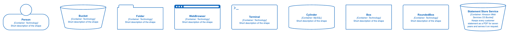 | 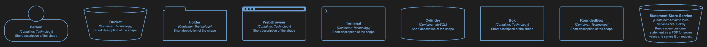 |

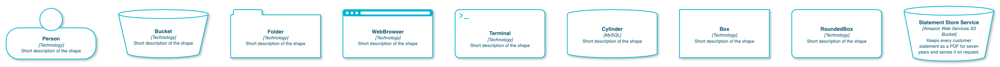

- Order, later wins per field: the theme, then tag styles in tag order (`Element`, the type tag,
  `External` and `Database` when a `_Ext` or `Db` macro added them, then the element's own tags
  in order), then the element's `$shape` and
  `$sprite`.
- Unknown keys, repeated keys and bad values are reported in the Problems panel and by
  `c4x-lint`; the diagram still renders.

Which shape for what, in the notation the c4model.com examples use:

| `$shape` | Use it for |
|---|---|
| `Person` | A person or a role |
| `Cylinder` | A database |
| `Bucket` | An object store |
| `Folder` | Files or a file system |
| `WebBrowser` | A web page or single-page app |
| `Terminal` | A command-line tool |
| `RoundedBox` | An element that needs a softer outline |
| `Box` | The plain rectangle |

A tag style in the same theme: `elementStyle Queue $shape="Cylinder", $stroke="#BF101D", $border="dashed"` gives every element tagged `Queue` the red dashed cylinder.

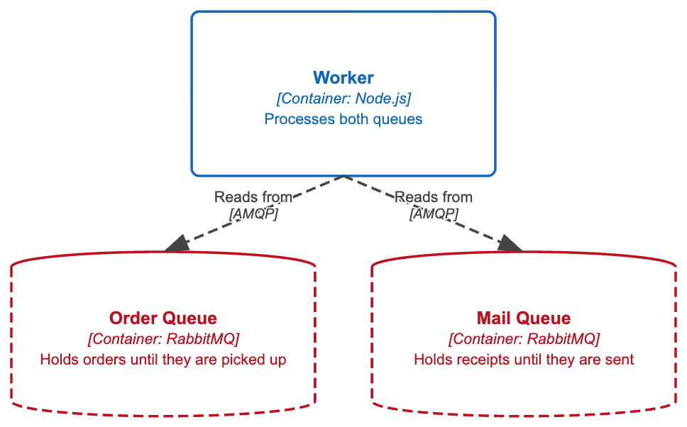

The editor offers every shape name after `$shape="`, the `$shape`, `$sprite`, `$tags` and `$code` names after a `$`, and the `elementStyle` keys after a tag. A diagram that uses shapes, a boundary and relationship technology looks like this in the `c4-model` theme:

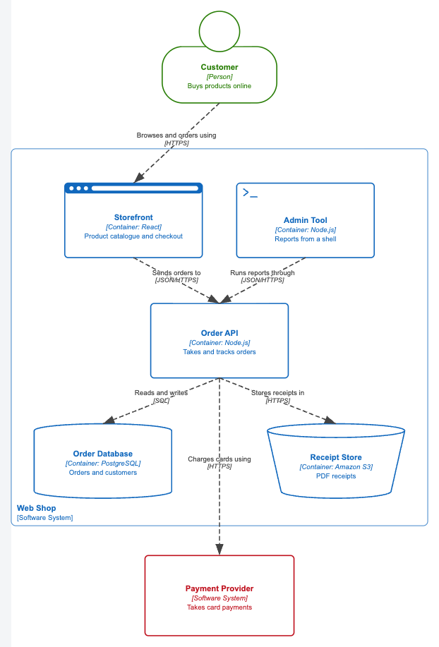

### The diagram key

The key lists the styles a diagram draws, with a swatch in each element's own shape. In the preview it is an overlay; set `c4x.export.includeKey` to add it below the diagram in exports. How an entry is named, and the settings, are in the [user guide](USER-GUIDE.md#the-diagram-key).

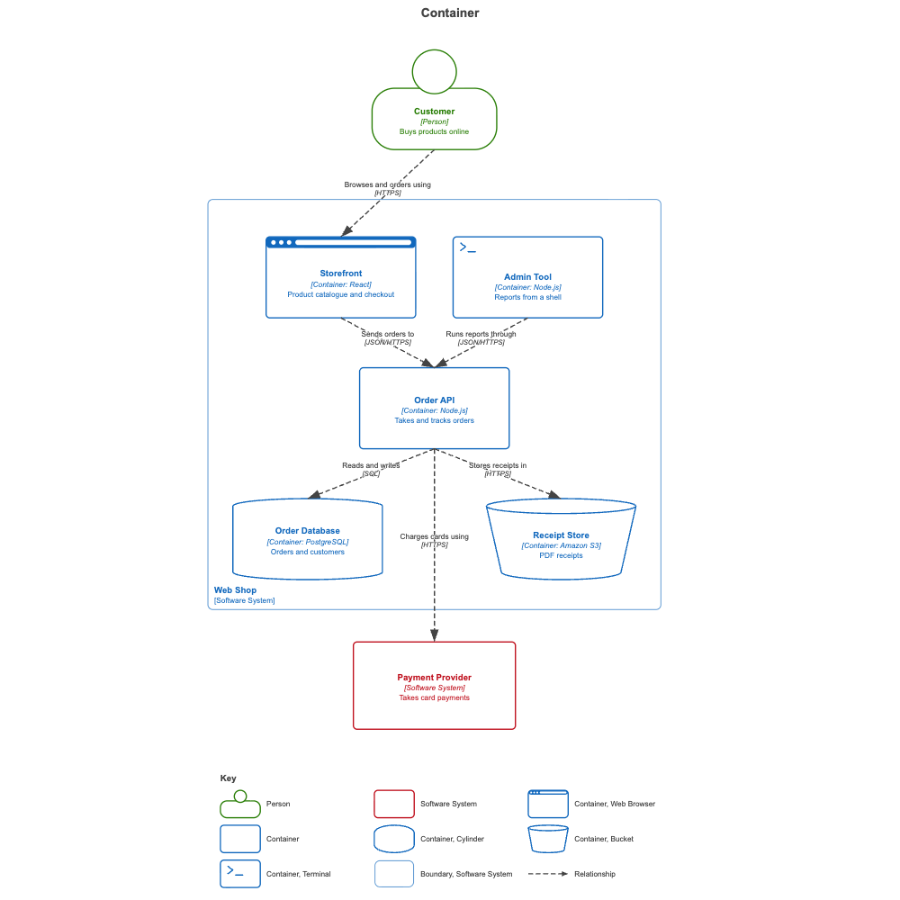

---

## Complete Examples

### System Context (C1) Diagram

```c4x
%%{ c4: system-context }%%
graph TB
    %% Actors
    Customer[Customer<br/>Person]
    Admin[Administrator<br/>Person]

    %% Systems
    WebApp[E-commerce Website<br/>Software System]
    PaymentGateway[Payment Gateway<br/>Software System<br/>External]
    EmailService[Email Service<br/>Software System<br/>External]

    %% Relationships
    Customer -->|Browses products, makes purchases| WebApp
    Admin -->|Manages products and orders| WebApp
    WebApp -->|Processes payments using| PaymentGateway
    WebApp -.->|Sends order confirmations via| EmailService
```

### Container (C2) Diagram

```c4x
%%{ c4: container }%%
graph TB
    %% External Actors
    Customer[Customer<br/>Person]

    %% E-commerce System Containers
    subgraph EcommerceSystem {
        WebApp[Web Application<br/>Container<br/>React]
        APIServer[API Server<br/>Container<br/>Node.js]
        Database[Customer Database<br/>Container<br/>PostgreSQL]
    }

    %% External Systems
    PaymentGateway[Payment Gateway<br/>Software System<br/>External]
    EmailService[Email Service<br/>Software System<br/>External]

    %% Relationships
    Customer -->|Uses| WebApp
    WebApp -->|Makes API calls to| APIServer
    APIServer -->|Reads/writes to| Database
    APIServer -->|Processes payments with| PaymentGateway
    APIServer -.->|Sends emails via| EmailService
```